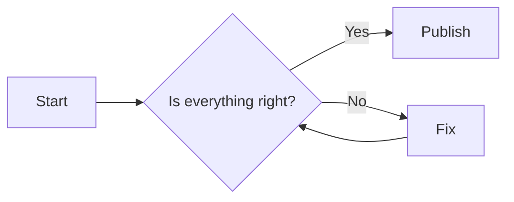

<a id="readme-top"></a>

<div align="center">

# Complete Guide to GitHub Markdown Formatting and Syntax

**How to write, format and enhance profile and project READMEs**


</div>

---

## Introduction

The README is the business card of a profile or a project on GitHub. It is the first thing visitors read and, very often, what decides whether they stay, use the project or follow the author.

This guide gathers, in an organised way, everything needed to write a good README:

- the **syntax** of Markdown supported by GitHub (*GitHub Flavored Markdown*), from basic to advanced;
- the **visual features** that make a README more appealing (badges, banners, statistics, icons);
- **ready-to-copy templates** for the profile README and the project README;
- **best practices**, a checklist and solutions to the most common problems.

### How to read the examples

For most topics, the guide shows two blocks:

- **Writing**: the code you type;
- **Result**: how that code looks once GitHub renders it.

> [!NOTE]
> So that the **Writing** examples appear as text instead of being rendered, they are placed inside code blocks. Just copy and adapt them.

<details>
<summary><strong>Table of contents</strong></summary>

**Syntax fundamentals**

1. [Introduction to Markdown](#1-introduction-to-markdown)
2. [Headings](#2-headings)
3. [Text formatting](#3-text-formatting)
4. [Paragraphs, line breaks and horizontal rules](#4-paragraphs-line-breaks-and-horizontal-rules)
5. [Aligning content](#5-aligning-content)
6. [Lists](#6-lists)
7. [Links](#7-links)
8. [Images, GIFs and videos](#8-images-gifs-and-videos)
9. [Blockquotes](#9-blockquotes)
10. [Code](#10-code)
11. [Alerts](#11-alerts)
12. [Hidden comments](#12-hidden-comments)
13. [Tables](#13-tables)
14. [Collapsed sections](#14-collapsed-sections)
15. [Footnotes](#15-footnotes)
16. [Emojis](#16-emojis)
17. [Mentions and references](#17-mentions-and-references)
18. [Math expressions](#18-math-expressions)
19. [Diagrams and maps](#19-diagrams-and-maps)
20. [Colors](#20-colors)
21. [Special characters and escaping](#21-special-characters-and-escaping)

**Visual features**

22. [Badges](#22-badges)
23. [Banners and animated text](#23-banners-and-animated-text)
24. [GitHub stats and graphs](#24-github-stats-and-graphs)
25. [Technology icons and social links](#25-technology-icons-and-social-links)

**Practical application**

26. [Profile README](#26-profile-readme)
27. [Project README](#27-project-readme)
28. [Supporting repository files](#28-supporting-repository-files)
29. [Best practices and checklist](#29-best-practices-and-checklist)
30. [Common problems and solutions](#30-common-problems-and-solutions)
31. [Quick reference](#31-quick-reference)
32. [Sources and useful links](#32-sources-and-useful-links)

</details>

---

## 1. Introduction to Markdown

**Markdown** is a simple markup language: with a few symbols (`#`, `*`, `-`, `>`) plain text becomes formatted text. GitHub uses a variant called **GitHub Flavored Markdown (GFM)**, which adds tables, task lists, alerts, diagrams, math expressions and other features.

### Where Markdown works on GitHub

| Location | Example |
| :--- | :--- |
| `.md` files | `README.md`, `CONTRIBUTING.md`, `CHANGELOG.md` |
| Issues and Pull Requests | Descriptions and comments |
| Discussions | Posts and replies |
| Gists | Files with the `.md` extension |
| Releases | Release notes |
| Wiki | Project pages |

### Where to edit

1. Directly on GitHub: open the file and click the pencil icon (**Edit this file**). The **Preview** tab shows the result before you save.
2. On your computer, with any editor (for example, Visual Studio Code, which has a Markdown preview with `Ctrl` + `Shift` + `V`).

### HTML inside Markdown

GitHub accepts part of HTML inside Markdown, which allows you to centre text, resize images, create collapsed sections and other effects. For security reasons, GitHub **removes** certain elements, such as `<script>`, `<style>`, `<iframe>`, forms and the `style` attribute. Attributes such as `target="_blank"` are also ignored.

<p align="right"><a href="#readme-top">↑ Back to top</a></p>

---

## 2. Headings

Headings organise content into levels. Type **one to six hash signs** (`#`) at the start of the line, followed by **a space** and the heading text.

| Level | Code | Typical use |
| :---: | :--- | :--- |
| 1 | `# Heading` | Project name (use only one per document) |
| 2 | `## Heading` | Main sections |
| 3 | `### Heading` | Subsections |
| 4 | `#### Heading` | Details within a subsection |
| 5 | `##### Heading` | Rarely used |
| 6 | `###### Heading` | Rarely used |

Writing:

```markdown
# Level 1 heading
## Level 2 heading
### Level 3 heading
#### Level 4 heading
##### Level 5 heading
###### Level 6 heading
```

Result (levels 4 to 6; levels 1 to 3 were left out so they do not change the table of contents of this guide):

#### Level 4 heading
##### Level 5 heading
###### Level 6 heading

> [!NOTE]
> The more hash signs, the smaller and less important the heading. Always leave a blank line before and after a heading.

### Automatic outline and anchors

- GitHub **automatically** generates an outline for any Markdown file with headings: click the list icon in the top-right corner of the file.
- When you hover over a heading, a link appears that lets you copy the direct address of that section.
- Each heading receives an **anchor** (internal address) created like this: lowercase letters, spaces replaced by hyphens and punctuation removed.

| Heading | Generated anchor |
| :--- | :--- |
| `## Installation` | `#installation` |
| `## How to Contribute` | `#how-to-contribute` |
| `## 1. Getting started` | `#1-getting-started` |

If two headings are identical, the second receives the suffix `-1`, the third `-2`, and so on.

<p align="right"><a href="#readme-top">↑ Back to top</a></p>

---

## 3. Text formatting

| Style | Writing | Result |
| :--- | :--- | :--- |
| Bold | `**text**` or `__text__` | **text** |
| Italic | `*text*` or `_text_` | *text* |
| Bold and italic | `***text***` | ***text*** |
| Strikethrough | `~~text~~` | ~~text~~ |
| Underline | `<ins>text</ins>` | <ins>text</ins> |
| Superscript | `x<sup>2</sup>` | x<sup>2</sup> |
| Subscript | `H<sub>2</sub>O` | H<sub>2</sub>O |
| Inline code | `` `text` `` | `text` |
| Keyboard key | `<kbd>Ctrl</kbd> + <kbd>C</kbd>` | <kbd>Ctrl</kbd> + <kbd>C</kbd> |

### Combinations

| Combination | Writing | Result |
| :--- | :--- | :--- |
| Bold inside italic | `_text **important** text_` | _text **important** text_ |
| Bold and strikethrough | `**~~text~~**` | **~~text~~** |
| Italic and strikethrough | `*~~text~~*` | *~~text~~* |

> [!TIP]
> Use **bold** to highlight key terms and *italics* for light emphasis or foreign words. Highlighting too much text means nothing stands out.

<p align="right"><a href="#readme-top">↑ Back to top</a></p>

---

## 4. Paragraphs, line breaks and horizontal rules

### Paragraphs

Separate paragraphs with **a blank line**. A simple line change, without a blank line, does **not** create a new paragraph in a `.md` file: the two lines appear joined together.

Writing:

```markdown
This is the first paragraph.

This is the second paragraph.
```

Result:

This is the first paragraph.

This is the second paragraph.

### Line break within the same paragraph

There are three ways:

| Method | How to do it |
| :--- | :--- |
| HTML tag (the most reliable) | Type `<br>` where you want the line to change |
| Two spaces | End the line with two spaces (invisible, easy to lose) |
| Backslash | End the line with `\` |

Writing:

```markdown
First line<br>
Second line<br><br>
Third line, after a blank line
```

Result:

First line<br>
Second line<br><br>
Third line, after a blank line

### Horizontal rule

Use three or more hyphens (`---`), asterisks (`***`) or underscores (`___`) on a line of their own. Leave **a blank line before it**: if `---` is stuck to the text above, that text turns into a heading.

Writing:

```markdown
Text above

---

Text below
```

Result:

Text above

---

Text below

<p align="right"><a href="#readme-top">↑ Back to top</a></p>

---

## 5. Aligning content

Plain Markdown does not align text, but GitHub accepts the HTML `align` attribute on `<div>` and `<p>`. Possible values: `left`, `center` and `right`. It works with text, images, GIFs and badges.

> [!IMPORTANT]
> Leave **a blank line** right after the opening `<div>` and before its closing tag; without it, the Markdown inside the `<div>` is not rendered.

Writing:

```markdown
<div align="center">

**Centred text**

</div>

<div align="right">

**Right-aligned text**

</div>
```

Result:

<div align="center">

**Centred text**

</div>

<div align="right">

**Right-aligned text**

</div>

For content without Markdown inside, you can use `<p align="center">...</p>`, with no need for blank lines:

```html
<p align="center">
  
</p>
```

<p align="right"><a href="#readme-top">↑ Back to top</a></p>

---

## 6. Lists

### Unordered list

Start each line with `-`, `*` or `+`, followed by a space. Choose a single symbol and keep it throughout the document.

Writing:

```markdown
- Apple
- Banana
- Orange
```

Result:

- Apple
- Banana
- Orange

### Ordered list

Start each line with a number followed by a period. GitHub numbers the items automatically, so you can repeat the number `1.` on every line: it makes reordering easier.

Writing:

```markdown
1. Download the project
1. Install the dependencies
1. Run the program
```

Result:

1. Download the project
1. Install the dependencies
1. Run the program

### Nested lists

Indent the sub-item with **two to four spaces** (or `Tab`) relative to the parent item.

Writing:

```markdown
1. Fruits
   - Apple
   - Banana
     - Plantain
2. Vegetables
   - Carrot
```

Result:

1. Fruits
   - Apple
   - Banana
     - Plantain
2. Vegetables
   - Carrot

### Task list

Use `- [ ]` for a pending task and `- [x]` for a completed one. Very useful in a roadmap.

Writing:

```markdown
- [x] Create the repository
- [x] Write the README
- [ ] Publish the first release
- [ ] \(Optional) Translate the documentation
```

Result:

- [x] Create the repository
- [x] Write the README
- [ ] Publish the first release
- [ ] \(Optional) Translate the documentation

> [!NOTE]
> If the text of a task starts with an opening parenthesis, you need to escape it with a backslash: `\(`.

### Paragraphs and code inside lists

To place a paragraph or a code block inside an item, leave a blank line and indent the content to the same level as the item text.

Writing:

````markdown
1. Clone the repository:

   ```bash
   git clone https://github.com/username/project.git
   ```

2. Enter the folder:

   ```bash
   cd project
   ```
````

Result:

1. Clone the repository:

   ```bash
   git clone https://github.com/username/project.git
   ```

2. Enter the folder:

   ```bash
   cd project
   ```

<p align="right"><a href="#readme-top">↑ Back to top</a></p>

---

## 7. Links

### Simple link

Link text between square brackets `[ ]` and the address between parentheses `( )`.

Writing:

```markdown
[GitHub profile](https://github.com/)
```

Result:

[GitHub profile](https://github.com/)

### Link with a title (tooltip on hover)

```markdown
[GitHub](https://github.com/ "Go to GitHub")
```

[GitHub](https://github.com/ "Go to GitHub")

### Automatic link

An address written in full becomes a link by itself; between `< >` it is explicit.

```markdown
https://github.com/
<https://github.com/>
```

### Reference-style link

Useful when the same address is repeated several times: define it once, at the end of the file, and use a name.

```markdown
See the [documentation][docs] or the project [guide][docs].

[docs]: https://docs.github.com/
```

### Email link

```markdown
[Send a message](mailto:name@example.com)
```

### Link to another section of the same file

Use `#` followed by the heading anchor (see [Headings](#2-headings)).

```markdown
See the [installation](#installation) section.
```

To create a custom anchor point (for example, for the "Back to top" button), place an HTML anchor where you want it:

```markdown
<a id="readme-top"></a>

[↑ Back to top](#readme-top)
```

### Relative links to other files in the repository

Relative links keep working if the repository changes its name, branch or owner. They are preferable to absolute links.

```markdown
[Contributing guide](./CONTRIBUTING.md)
[License](LICENSE)
[Documentation](docs/guide.md)
```

### Link to lines of code

In a repository file, click the line number, press `y` to get the permanent address and copy it. For a range, use `#L10-L20` at the end of the address.

### Image as a link

The image goes inside the square brackets of the link.

Writing:

```markdown
[](https://github.com/)
```

Result:

[](https://github.com/)

In HTML:

```html
<a href="https://github.com/"></a>
```

> [!WARNING]
> GitHub ignores `target="_blank"`: it is not possible to force a link to open in a new tab from a README.

<p align="right"><a href="#readme-top">↑ Back to top</a></p>

---

## 8. Images, GIFs and videos

### Basic syntax

It is the same as for a link, with an exclamation mark `!` at the start. The text between square brackets is the **alternative text**, read by screen readers and shown if the image fails to load. **Always write it.**

```markdown

```

### Image sources

| Source | Example |
| :--- | :--- |
| Inside the repository (recommended) | `` |
| External address | `` |
| Drag into the GitHub editor | GitHub uploads the file and generates the address |

Good practice: keep images in a dedicated folder (`assets/`, `images/` or `docs/`), with file names that contain no spaces.

### Resizing images

Markdown does not set dimensions; use HTML. Give **only the width** to keep the proportions.

```html

```

### Centring an image

```html
<p align="center">
  
</p>
```

### Different images for light mode and dark mode

The `<picture>` element with `prefers-color-scheme` shows the image that suits the visitor's theme. It is especially useful for logos and banners.

Writing:

```html
<picture>
  <source media="(prefers-color-scheme: dark)" srcset="assets/logo-dark.png">
  <source media="(prefers-color-scheme: light)" srcset="assets/logo-light.png">
  
</picture>
```

- `srcset` of the dark mode: image for visitors using the dark theme;
- `srcset` of the light mode: image for visitors using the light theme;
- `src` of the `` tag: default image, used if the browser does not support `<picture>`;
- `alt`: description for accessibility.

A simpler alternative (less recommended): add `#gh-dark-mode-only` or `#gh-light-mode-only` to the end of the image address.

```markdown


```

### GIFs

A GIF animates like any image. They are excellent for showing how an application works in a few seconds. Keep them light (ideally under 5 MB).

```markdown

```

### Videos

In the GitHub editor (in Issues, Pull Requests or when editing a README on the site), **drag** an `.mp4`, `.mov` or `.webm` file into the text box. GitHub uploads the video and inserts the address, and it is then played directly on the page.

> [!TIP]
> For longer videos (for example, on YouTube), use a preview image linked to the video:
>
> ```markdown
> [](https://www.youtube.com/watch?v=VIDEO_ID)
> ```

<p align="right"><a href="#readme-top">↑ Back to top</a></p>

---

## 9. Blockquotes

Start the line with `>`. It is used to quote texts, highlight remarks or reply to someone.

Writing:

```markdown
> This is a quote.
>
> It can have several paragraphs.
>
>> And it can have quotes inside quotes.
```

Result:

> This is a quote.
>
> It can have several paragraphs.
>
>> And it can have quotes inside quotes.

> [!NOTE]
> To draw attention to warnings and tips, prefer [Alerts](#11-alerts).

<p align="right"><a href="#readme-top">↑ Back to top</a></p>

---

## 10. Code

### Inline code

Place the text between **backticks** (`` ` ``). Use it for command names, files, variables and functions.

Writing:

```markdown
Run the `npm install` command and open the `index.html` file.
```

Result:

Run the `npm install` command and open the `index.html` file.

If the code itself contains backticks, wrap it with **double backticks** and spaces:

```markdown
`` Use `backticks` like this ``
```

### Code block

Use **three backticks** before and after the code.

Writing:

````markdown
```
npm install
npm start
```
````

Result:

```
npm install
npm start
```

### Syntax highlighting

Name the language right after the opening three backticks.

Writing:

````markdown
```html
<!doctype html>
<html lang="en">
<head>
  <meta charset="utf-8">
  <title>Test page</title>
</head>
<body>
  <h1>Hello, world!</h1>
</body>
</html>
```
````

Result:

```html
<!doctype html>
<html lang="en">
<head>
  <meta charset="utf-8">
  <title>Test page</title>
</head>
<body>
  <h1>Hello, world!</h1>
</body>
</html>
```

Most commonly used language identifiers:

| Language | Identifier | Language | Identifier |
| :--- | :--- | :--- | :--- |
| JavaScript | `javascript` or `js` | Python | `python` or `py` |
| TypeScript | `typescript` or `ts` | Java | `java` |
| HTML | `html` | C# | `csharp` |
| CSS | `css` | PHP | `php` |
| JSON | `json` | SQL | `sql` |
| YAML | `yaml` | Command line | `bash` or `shell` |
| Markdown | `markdown` or `md` | Differences between versions | `diff` |

### Showing changes with `diff`

```diff
- removed line
+ added line
  unchanged line
```

### Showing Markdown code that contains code blocks

When the example contains three backticks, wrap it with **four backticks** (as in this guide):

`````markdown
````markdown
```js
console.log("Hello");
```
````
`````

### Folder structure

Use a plain code block, with no language:

```
project/
├── src/
│   ├── index.js
│   └── utils.js
├── docs/
├── README.md
└── LICENSE
```

<p align="right"><a href="#readme-top">↑ Back to top</a></p>

---

## 11. Alerts

Alerts are an extension of blockquotes that highlight important information, with their own colour and icon. They are supported in Markdown files, Issues, Pull Requests, Discussions, Gists and Releases.

There are **five types**:

| Type | When to use |
| :--- | :--- |
| `NOTE` | Useful information that readers should know, even when skimming |
| `TIP` | Advice to do something better or faster |
| `IMPORTANT` | Essential information for achieving the goal |
| `WARNING` | Warning of a risk that requires immediate attention |
| `CAUTION` | Warning of serious negative consequences |

Writing:

```markdown
> [!NOTE]
> Useful information.

> [!TIP]
> Practical advice.

> [!IMPORTANT]
> Essential information.

> [!WARNING]
> Risk that requires attention.

> [!CAUTION]
> Possible serious consequences.
```

Result:

> [!NOTE]
> Useful information.

> [!TIP]
> Practical advice.

> [!IMPORTANT]
> Essential information.

> [!WARNING]
> Risk that requires attention.

> [!CAUTION]
> Possible serious consequences.

> [!TIP]
> GitHub recommends using **at most one or two alerts per document** and avoiding consecutive alerts, so the reader is not overwhelmed. Alerts cannot be placed inside other elements.

<p align="right"><a href="#readme-top">↑ Back to top</a></p>

---

## 12. Hidden comments

Text placed between `<!--` and `-->` does not appear on the page. It is useful for leaving notes to yourself, instructions for other collaborators or temporarily disabling a block.

Writing:

```markdown
This word <!-- hidden --> is visible, but the word between the signs is not.

<!--
Reminder: update the screenshots before the next release.
-->
```

Result:

This word <!-- hidden --> is visible, but the word between the signs is not.

<!--
Reminder: update the screenshots before the next release.
-->

> [!WARNING]
> Comments are hidden on the page, but **remain visible** in the source code. Never put passwords, keys or confidential data in them.

<p align="right"><a href="#readme-top">↑ Back to top</a></p>

---

## 13. Tables

Use vertical bars `|` to separate columns and, on the second line, hyphens `-` to mark the header (minimum of three per column). Leave **a blank line before the table**.

Writing:

```markdown
| Name   | Role       | Status   |
| ------ | ---------- | -------- |
| Ana    | Developer  | Active   |
| Carlos | Designer   | On leave |
```

Result:

| Name   | Role       | Status   |
| ------ | ---------- | -------- |
| Ana    | Developer  | Active   |
| Carlos | Designer   | On leave |

### Column alignment

Place colons `:` on the hyphen line:

| Code | Alignment |
| :---: | :--- |
| `:---` | left |
| `:---:` | centre |
| `---:` | right |

Writing:

```markdown
| Left       | Centre    | Right    |
| :--------- | :-------: | -------: |
| Text       | Text      | 100.00   |
| Text       | Text      | 2,500.00 |
```

Result:

| Left       | Centre    | Right    |
| :--------- | :-------: | -------: |
| Text       | Text      | 100.00   |
| Text       | Text      | 2,500.00 |

### Inside cells

| You want | Write |
| :--- | :--- |
| Vertical bar `\|` | `\|` |
| Line break | `<br>` |
| Code | `` `code` `` |
| Link or image | `[text](url)` or `` |

> [!NOTE]
> Cells do not need to be perfectly aligned in the code, but aligning them makes the table much easier to read and edit. The vertical bars at the edges are optional.

<p align="right"><a href="#readme-top">↑ Back to top</a></p>

---

## 14. Collapsed sections

With `<details>` and `<summary>`, content stays hidden until the reader clicks the title. It is ideal for tables of contents, long lists, error logs and technical details that are not of interest to everyone.

Writing:

````markdown
<details>
<summary>Click to see the details</summary>

### It can have a heading

It can have text, lists, images and code blocks.

```python
print("Hello, world!")
```

</details>
````

Result:

<details>
<summary>Click to see the details</summary>

### It can have a heading

It can have text, lists, images and code blocks.

```python
print("Hello, world!")
```

</details>

### Section already open by default

Add the `open` attribute:

```html
<details open>
<summary>This section starts open</summary>

Content visible from the start.

</details>
```

> [!IMPORTANT]
> Leave **a blank line** after `</summary>` and before `</details>`; otherwise the Markdown inside will not be rendered.

<p align="right"><a href="#readme-top">↑ Back to top</a></p>

---

## 15. Footnotes

Footnotes let you add references or clarifications without interrupting the text. GitHub numbers them automatically and places them at the end of the document, with a link back.

Writing:

```markdown
Markdown was created in 2004.[^history] Many developers use it daily.[^usage]

[^history]: Its authors were John Gruber and Aaron Swartz.
[^usage]: Mainly in documentation and README files.
```

Result:

Markdown was created in 2004.[^history] Many developers use it daily.[^usage]

[^history]: Its authors were John Gruber and Aaron Swartz.
[^usage]: Mainly in documentation and README files.

> [!NOTE]
> Footnotes do not work inside tables, blockquotes or `<details>` sections.

<p align="right"><a href="#readme-top">↑ Back to top</a></p>

---

## 16. Emojis

Type the emoji name between two colons (`:name:`) or paste the emoji itself. Type `:` and the first letters in the GitHub editor to see suggestions.

Writing:

```markdown
:rocket: Launch! :tada: All set :white_check_mark:
```

Result:

:rocket: Launch! :tada: All set :white_check_mark:

| Emoji | Code | Emoji | Code |
| :---: | :--- | :---: | :--- |
| :rocket: | `:rocket:` | :bulb: | `:bulb:` |
| :books: | `:books:` | :wrench: | `:wrench:` |
| :sparkles: | `:sparkles:` | :bug: | `:bug:` |
| :globe_with_meridians: | `:globe_with_meridians:` | :handshake: | `:handshake:` |
| :email: | `:email:` | :warning: | `:warning:` |

Full list: [Emoji Cheat Sheet](https://github.com/ikatyang/emoji-cheat-sheet).

> [!TIP]
> Emojis are great for marking sections (for example, `## :rocket: Installation`), but use them sparingly. Note: in headings, the emoji becomes part of the generated anchor.

<p align="right"><a href="#readme-top">↑ Back to top</a></p>

---

## 17. Mentions and references

In Issues, Pull Requests, Discussions and comments, GitHub automatically turns certain text into links:

| Writing | Result |
| :--- | :--- |
| `@username` | Mentions a person and notifies them |
| `@organisation/team` | Mentions a team in an organisation |
| `#123` | Links to issue or pull request number 123 in the same repository |
| `username/repository#123` | Links to an issue in another repository |
| `a5c3785` (start of a commit SHA) | Links to the commit |
| `Fixes #123` or `Closes #123` | In a pull request, closes the issue when the PR is merged |

> [!NOTE]
> These automatic links are **not** created inside `.md` files in the repository (such as the README). In a README, use full links:
>
> ```markdown
> [See issue 123](https://github.com/username/repository/issues/123)
> ```

<p align="right"><a href="#readme-top">↑ Back to top</a></p>

---

## 18. Math expressions

GitHub renders **LaTeX** expressions between dollar signs (`$ ... $`) inline and between double dollar signs (`$$ ... $$`) in a block of their own.

Writing:

```markdown
The formula is $x = \frac{-b \pm \sqrt{b^2 - 4ac}}{2a}$ for quadratic equations.

$$
\sum_{i=1}^{n} i = \frac{n(n+1)}{2}
$$
```

Result:

The formula is $x = \frac{-b \pm \sqrt{b^2 - 4ac}}{2a}$ for quadratic equations.

$$
\sum_{i=1}^{n} i = \frac{n(n+1)}{2}
$$

To write a dollar sign as normal text (for example, a price), use `\$`.

<p align="right"><a href="#readme-top">↑ Back to top</a></p>

---

## 19. Diagrams and maps

### Diagrams with Mermaid

Write the diagram in a code block with the `mermaid` language. GitHub draws it directly, with no images.

Writing:

````markdown

````

Result:


Mermaid supports flowcharts, sequence diagrams, class diagrams, state diagrams, Gantt charts, pie charts and more. Documentation: [mermaid.js.org](https://mermaid.js.org/).

### Maps (GeoJSON and TopoJSON)

A block with the `geojson` language displays an interactive map:

````markdown
```geojson
{
  "type": "Feature",
  "geometry": { "type": "Point", "coordinates": [-0.1278, 51.5074] },
  "properties": { "name": "Example" }
}
```
````

### 3D models (STL)

A block with the `stl` language shows a three-dimensional model. `.stl` files in the repository are also displayed in 3D in the browser.

<p align="right"><a href="#readme-top">↑ Back to top</a></p>

---

## 20. Colors

In Issues, Pull Requests and Discussions, colour codes written as inline code show a small colour swatch:

```markdown
`#0969DA`
`rgb(9, 105, 218)`
`hsl(212, 92%, 45%)`
```

> [!NOTE]
> This effect does not occur in `.md` files in the repository. To show colours in a README, use an image or a badge (see [section 22](#22-badges)): for example, ``.

<p align="right"><a href="#readme-top">↑ Back to top</a></p>

---

## 21. Special characters and escaping

To show literally a symbol that Markdown would use for formatting, place a **backslash** (`\`) before it.

Writing:

```markdown
\*This is not in italics\*
\# This is not a heading
1\. This is not a list
```

Result:

\*This is not in italics\*

\# This is not a heading

1\. This is not a list

Characters that can be escaped:

```
\   `   *   _   {}   []   ()   #   +   -   .   !   |   <   >   ~   $
```

When the text contains `<` or `>` and GitHub confuses them with HTML, write `&lt;` and `&gt;`. For a non-breaking space, use `&nbsp;`.

<p align="right"><a href="#readme-top">↑ Back to top</a></p>

---

## 22. Badges

**Badges** are small images that summarise information: build status, version, licence, technologies, social links, and so on. The most widely used service is [Shields.io](https://shields.io/).

### Static badge

Format:

```
https://img.shields.io/badge/LABEL-MESSAGE-COLOR
```

Address rules:

| To write | Use |
| :--- | :--- |
| Space | `_` or `%20` |
| Hyphen `-` | `--` |
| Underscore `_` | `__` |
| Accents and special characters | Encoded (for example, `Licen%C3%A7a` for "Licença") |

Writing:

```markdown


```

Result:


### Useful parameters

They are added to the address, after `?`, separated by `&`.

| Parameter | Purpose | Example |
| :--- | :--- | :--- |
| `style` | Badge style | `style=for-the-badge` |
| `logo` | Logo (icon name from [Simple Icons](https://simpleicons.org/)) | `logo=python` |
| `logoColor` | Logo colour | `logoColor=white` |
| `labelColor` | Colour of the label part | `labelColor=black` |
| `color` | Colour of the message (name or hexadecimal code without `#`) | `color=0969DA` |

Available styles: `flat` (default), `flat-square`, `plastic`, `for-the-badge` and `social`.

Writing:

```markdown


```

Result:


> [!NOTE]
> Some brand logos have been removed from Simple Icons over time, so they may stop appearing. In that case the badge keeps working, just without the logo. Always confirm the icon name at [simpleicons.org](https://simpleicons.org/).

### Dynamic GitHub badges

These badges update themselves by reading data from the repository. Replace `USERNAME/REPOSITORY` with your own details.

| Information | Address |
| :--- | :--- |
| Stars | `https://img.shields.io/github/stars/USERNAME/REPOSITORY?style=social` |
| Forks | `https://img.shields.io/github/forks/USERNAME/REPOSITORY?style=social` |
| License | `https://img.shields.io/github/license/USERNAME/REPOSITORY` |
| Latest release | `https://img.shields.io/github/v/release/USERNAME/REPOSITORY` |
| Last commit | `https://img.shields.io/github/last-commit/USERNAME/REPOSITORY` |
| Open issues | `https://img.shields.io/github/issues/USERNAME/REPOSITORY` |
| Main language | `https://img.shields.io/github/languages/top/USERNAME/REPOSITORY` |
| Repository size | `https://img.shields.io/github/repo-size/USERNAME/REPOSITORY` |
| User followers | `https://img.shields.io/github/followers/USERNAME?style=social` |
| Workflow status (Actions) | `https://img.shields.io/github/actions/workflow/status/USERNAME/REPOSITORY/NAME.yml` |

Example with a real repository:

```markdown


```


### Badges with a link

```markdown
[](./LICENSE)
```

> [!TIP]
> Do not overdo it: three to six relevant badges, grouped at the top, make a good impression. Dozens of badges make the README hard to read.

<p align="right"><a href="#readme-top">↑ Back to top</a></p>

---

## 23. Banners and animated text

These features are provided by **free external services** and are mainly used in profile READMEs.

> [!WARNING]
> External services may become slow, change address or stop working. For essential elements (such as your project logo), store the image in the repository itself. Always test the address before publishing.

### Decorative header and footer (Capsule Render)

Generates banners with waves, gradients and text.

```markdown

```

For the footer, use `section=footer`. Available types include `waving`, `venom`, `shark`, `slice`, `rect`, `cylinder` and others.

### Typing text (Readme Typing SVG)

Shows phrases that are typed one after another. Separate phrases with `;` and use `+` for spaces.

```markdown
[](https://git.io/typing-svg)
```

### Profile view counter image

```markdown

```

### Snake eating your contributions

The [Platane/snk](https://github.com/Platane/snk) project generates, through a **GitHub Action**, an animation in which a snake "eats" your contribution graph. Follow the instructions in the repository to create the workflow and then insert the generated SVG file into your README.

<p align="right"><a href="#readme-top">↑ Back to top</a></p>

---

## 24. GitHub stats and graphs

All the cards below are images generated by external services from the public data of your profile. Replace `USERNAME` with your GitHub username.

### General stats (GitHub Readme Stats)

```markdown

```

Useful parameters: `theme` (for example, `dark`, `radical`, `tokyonight`), `hide_border=true`, `include_all_commits=true`, `count_private=true`.

### Most used languages

```markdown

```

### Repository card

Ideal for highlighting projects.

```markdown
[](https://github.com/USERNAME/REPOSITORY-NAME)
```

### Contribution streak

```markdown

```

### Trophies

```markdown

```

### Activity graph

```markdown

```

> [!NOTE]
> The public instance of *GitHub Readme Stats* has request limits and may fail often. If that happens, the solution recommended by the project itself is to host your own instance (for example, on Vercel). See the [anuraghazra/github-readme-stats](https://github.com/anuraghazra/github-readme-stats) repository.

### Side-by-side cards

Place the images in a centred `<div>`, with no blank lines between them:

```html
<div align="center">
  
  
</div>
```

<p align="right"><a href="#readme-top">↑ Back to top</a></p>

---

## 25. Technology icons and social links

### Technology icons (Skill Icons)

A single image shows a row of icons, specified by name and separated by commas.

```markdown

```

Parameters: `&theme=light` (icons for a light background) and `&perline=6` (number of icons per line). Icon list: [skillicons.dev](https://skillicons.dev/).

### Technology badges

An alternative using Shields.io badges (see [section 22](#22-badges)), which allows custom colours and names:

```markdown


```


### Social and contact links

Combine a badge with a link:

```markdown
[](https://github.com/USERNAME)
[](https://wa.me/NUMBER_WITH_COUNTRY_CODE)
[](https://t.me/USERNAME)
[](mailto:name@example.com)
```

> [!CAUTION]
> A profile README is **public**. Think carefully before publishing your phone number, home address or other sensitive data.

List of all available badges: [markdown-badges](https://github.com/Ileriayo/markdown-badges).

<p align="right"><a href="#readme-top">↑ Back to top</a></p>

---

## 26. Profile README

The profile README is a file that appears **at the top of your GitHub profile page**, before the pinned repositories. It is your chance to introduce yourself.

### How to create it

1. Click **New** to create a new repository.
2. Give the repository **exactly the same name as your GitHub username** (for example, if the username is `ana-silva`, the repository is called `ana-silva`).
3. Select the **Public** option.
4. Select **Add a README file**. GitHub shows a message confirming that this is a special repository.
5. Click **Create repository**.
6. Edit the `README.md` and save (*Commit changes*). The content now appears on your profile.

> [!IMPORTANT]
> The repository must be **public** and its name must be **identical** to the username (no differences in letters). Otherwise, the README will not appear on the profile.

### What to include

| Element | Purpose |
| :--- | :--- |
| Title or banner | Makes a good first visual impression |
| Short introduction | Who you are, what you do, where you study or work |
| Technologies | Shows your skills |
| Featured projects | Draws visitors to your work |
| Stats | Shows activity (optional) |
| Contacts and social links | Makes it easy to get in touch |
| Goals and interests | Humanises the profile |

### Complete profile README template

Copy it, paste it into the `README.md` of the profile repository and replace everything in CAPITALS.

````markdown
<div align="center">


[](https://git.io/typing-svg)

</div>

## :wave: About me

- :mortar_board: I study YOUR COURSE at YOUR INSTITUTION
- :telescope: I am currently working on **PROJECT NAME**
- :seedling: I am learning **TECHNOLOGY**
- :handshake: I would like to collaborate on **FIELD** projects
- :speech_balloon: Ask me about **TOPIC**
- :earth_africa: I live in YOUR CITY, YOUR COUNTRY

## :hammer_and_wrench: Technologies


## :bar_chart: Stats

<div align="center">


</div>

## :file_folder: Featured projects

| Project | Description | Technologies |
| :--- | :--- | :--- |
| [Project 1](https://github.com/USERNAME/project-1) | Short description | HTML, CSS, JS |
| [Project 2](https://github.com/USERNAME/project-2) | Short description | Python |

## :email: Contact

[](https://github.com/USERNAME)
[](mailto:name@example.com)


````

### Tips for the profile

- Keep it **short and up to date**: visitors read it in seconds.
- Test the page in **light and dark mode** and on a mobile phone.
- Pin up to six repositories you are most proud of.
- Use the profile repository to store the README images too.

<p align="right"><a href="#readme-top">↑ Back to top</a></p>

---

## 27. Project README

The project README explains **what the project is, what it is for and how to use it**. Whoever opens it wants quick answers to five questions:

1. What is this?
2. What is it for?
3. How do I install it?
4. How do I use it?
5. How can I help or get help?

### Where GitHub looks for the README

GitHub shows the README on the repository's home page. If there are several, it chooses one in this order of priority:

1. the `.github` folder;
2. the repository root;
3. the `docs` folder.

> [!NOTE]
> GitHub only displays the first **500 KiB** of a README; anything beyond that limit is cut off. For extensive documentation, split the content into files under `docs/` and link to them from the README.

### Recommended structure

| Order | Section | Content |
| :---: | :--- | :--- |
| 1 | Title, logo and badges | Project name, image and status |
| 2 | Description | One or two sentences about what the project does |
| 3 | Demo | Screenshot, GIF or link to the online version |
| 4 | Table of contents | Essential in long READMEs |
| 5 | Features | List of the main characteristics |
| 6 | Technologies | Languages, frameworks and tools |
| 7 | Prerequisites | What needs to be installed |
| 8 | Installation | Numbered steps, with code |
| 9 | Usage | Practical examples of use |
| 10 | Configuration | Variables, options, configuration files |
| 11 | Project structure | Folder tree (optional) |
| 12 | Tests | How to run the tests |
| 13 | Roadmap | Planned features (task list) |
| 14 | Contributing | Rules for collaborating |
| 15 | License | Type of licence |
| 16 | Authors and acknowledgements | Credits |
| 17 | Contact and support | Where to ask for help |

### Complete project README template

Copy it into the project's `README.md` and adapt it. Delete the sections that do not apply.

````markdown
<a id="readme-top"></a>

<div align="center">

<picture>
  <source media="(prefers-color-scheme: dark)" srcset="assets/logo-dark.png">
  <source media="(prefers-color-scheme: light)" srcset="assets/logo-light.png">
  
</picture>

# PROJECT NAME

**A short sentence explaining what the project does.**


[Demo](https://example.com) · [Documentation](./docs) · [Report a bug](https://github.com/USERNAME/REPOSITORY/issues) · [Request a feature](https://github.com/USERNAME/REPOSITORY/issues)

</div>

<details>
<summary><strong>Table of contents</strong></summary>

- [About the project](#about-the-project)
- [Features](#features)
- [Technologies](#technologies)
- [Getting started](#getting-started)
  - [Prerequisites](#prerequisites)
  - [Installation](#installation)
- [Usage](#usage)
- [Configuration](#configuration)
- [Project structure](#project-structure)
- [Roadmap](#roadmap)
- [Contributing](#contributing)
- [License](#license)
- [Authors](#authors)
- [Acknowledgements](#acknowledgements)

</details>

---

## About the project

Describe the problem the project solves, who it is for and what sets it apart from other solutions.

<p align="center">
  
</p>

## Features

- :white_check_mark: Feature 1
- :white_check_mark: Feature 2
- :white_check_mark: Feature 3

## Technologies


## Getting started

### Prerequisites

- [Node.js](https://nodejs.org/) 18 or later
- [Git](https://git-scm.com/)

### Installation

1. Clone the repository:

   ```bash
   git clone https://github.com/USERNAME/REPOSITORY.git
   ```

2. Enter the project folder:

   ```bash
   cd REPOSITORY
   ```

3. Install the dependencies:

   ```bash
   npm install
   ```

4. Start the application:

   ```bash
   npm start
   ```

## Usage

Explain, with examples, how to use the project:

```js
import { feature } from "PROJECT-NAME";

feature("example");
```

## Configuration

| Variable | Description | Default value |
| :--- | :--- | :--- |
| `PORT` | Port on which the application starts | `3000` |
| `API_URL` | API address | `http://localhost:8080` |

## Project structure

```
REPOSITORY/
├── src/
├── assets/
├── docs/
├── README.md
└── LICENSE
```

## Roadmap

- [x] Initial version
- [ ] User authentication
- [ ] Translation into other languages

See the [open issues](https://github.com/USERNAME/REPOSITORY/issues) for the full list of proposals.

## Contributing

Contributions are welcome. Read the [contributing guide](./CONTRIBUTING.md) and follow these steps:

1. Fork the project
2. Create a branch for your change (`git checkout -b feature/my-feature`)
3. Commit your changes (`git commit -m "Add my feature"`)
4. Push the branch (`git push origin feature/my-feature`)
5. Open a Pull Request

## License

Distributed under the MIT License. See the [LICENSE](./LICENSE) file for more information.

## Authors

- **YOUR NAME**: [@USERNAME](https://github.com/USERNAME)

## Acknowledgements

- [Shields.io](https://shields.io/)
- [Choose a License](https://choosealicense.com/)

<p align="right"><a href="#readme-top">↑ Back to top</a></p>
````

<p align="right"><a href="#readme-top">↑ Back to top</a></p>

---

## 28. Supporting repository files

Besides the README, GitHub recognises other files that make a project look professional. The **Insights → Community Standards** tab of the repository shows what is missing.

| File | Purpose | Location |
| :--- | :--- | :--- |
| `LICENSE` | Defines what others may do with the code. Without a licence, nobody has permission to reuse it. For help choosing: [choosealicense.com](https://choosealicense.com/) | Root |
| `CONTRIBUTING.md` | Explains how to collaborate (code rules, branches, tests) | Root, `.github` or `docs` |
| `CODE_OF_CONDUCT.md` | Community behaviour rules | Root, `.github` or `docs` |
| `SECURITY.md` | How to report security vulnerabilities | Root, `.github` or `docs` |
| `CHANGELOG.md` | History of changes by version (template at [keepachangelog.com](https://keepachangelog.com/)) | Root |
| `CITATION.cff` | Allows the project to be cited in academic work (the **Cite this repository** button appears) | Root |
| `.gitignore` | List of files that Git should ignore | Root |
| `.github/ISSUE_TEMPLATE/` | Templates for opening issues (bug, suggestion, question) | `.github` |
| `.github/PULL_REQUEST_TEMPLATE.md` | Template for describing pull requests | `.github` |
| `.github/FUNDING.yml` | Shows the **Sponsor** button | `.github` |

> [!TIP]
> If the same person maintains many repositories, they can create a public repository called `.github` in their account or organisation, with community files that will be used by default in all repositories that do not have their own.

### Organisation README

You can also create a README for an **organisation**: create a public repository called `.github` and, inside it, a `profile` folder with a `README.md` file.

<p align="right"><a href="#readme-top">↑ Back to top</a></p>

---

## 29. Best practices and checklist

### Writing

- Write for someone who **does not know** the project: avoid unexplained acronyms.
- Start with the essentials: what it is, what it is for and how to use it.
- Use short sentences, imperative verbs in instructions ("Install", "Run") and a consistent tone.
- Choose **one main language** and, if possible, offer translations in separate files (for example, `README.pt.md`).
- Proofread before publishing.

### Structure

- Use **a single level 1 heading**, the project name.
- Do not skip levels (from `##` straight to `####`).
- Include a **table of contents** in long documents.
- Split extensive content into several files and link them together.

### Visual

- Use **light** images and GIFs with alternative text.
- Prefer relative paths for images in the repository itself.
- Limit badges and effects: content matters more than decoration.
- Check readability in light and dark modes.

### Maintenance

- Update the README whenever installation, usage or dependencies change.
- Test the installation commands in a clean environment.
- Periodically check that external links and images still work.

### Final checklist

- [ ] The title and description clearly explain the project
- [ ] There is a screenshot, GIF or usage example
- [ ] The installation instructions have been tested
- [ ] Code examples have syntax highlighting
- [ ] All images have alternative text
- [ ] All links work
- [ ] The licence is stated
- [ ] There is a way to contact the author or ask for help
- [ ] There is no confidential data (passwords, keys, phone numbers)
- [ ] The preview was checked on GitHub (**Preview**)

<p align="right"><a href="#readme-top">↑ Back to top</a></p>

---

## 30. Common problems and solutions

| Problem | Probable cause | Solution |
| :--- | :--- | :--- |
| The table appears as plain text | Missing blank line before the table or the hyphen line is badly written | Leave a blank line before it and use at least three hyphens per column |
| Markdown inside `<div>` or `<details>` is not formatted | Missing blank line after the opening tag | Leave a blank line after the opening tag (and after `</summary>`) |
| The image does not appear | Wrong path, name with spaces or uppercase/lowercase mismatch | Check the exact path; avoid spaces and accents in file names |
| The image appears on GitHub but not elsewhere | Relative path | Use an absolute address wherever the README is copied outside GitHub |
| The internal link (`#section`) does not work | Anchor written differently from the heading | Copy the section address by hovering over the heading |
| The line break does not work | Simple line change in a `.md` | Use `<br>`, two spaces or `\` at the end of the line |
| The heading is not recognised | Missing space after `#` | Write `# Heading`, not `#Heading` |
| `---` turned the text into a heading | Horizontal rule stuck to the previous paragraph | Leave a blank line before `---` |
| The HTML style or script does not work | GitHub removes `<style>`, `<script>`, `style=""` | Use only supported tags and attributes |
| `target="_blank"` has no effect | GitHub ignores the attribute | It is not possible; let the reader decide |
| Stats cards do not load | External service unavailable or request limit reached | Try again later or host your own instance |
| The profile README does not appear | Private repository or name different from the username | Make the repository public and give it exactly the username |
| The alert appears as a normal quote | Wrong syntax | The first line must be only `> [!NOTE]`, with the type in capitals |

<p align="right"><a href="#readme-top">↑ Back to top</a></p>

---

## 31. Quick reference

| Element | Syntax |
| :--- | :--- |
| Heading | `# Heading` to `###### Heading` |
| Bold | `**text**` |
| Italic | `*text*` |
| Strikethrough | `~~text~~` |
| Underline | `<ins>text</ins>` |
| Superscript / subscript | `<sup>2</sup>` / `<sub>2</sub>` |
| Key | `<kbd>Ctrl</kbd>` |
| Line break | `<br>` |
| Horizontal rule | `---` |
| List | `- item` |
| Ordered list | `1. item` |
| Task list | `- [x] done` / `- [ ] to do` |
| Link | `[text](url)` |
| Image | `` |
| Image with link | `[](url)` |
| Blockquote | `> text` |
| Inline code | `` `code` `` |
| Code block | ```` ```language ```` … ```` ``` ```` |
| Alert | `> [!NOTE]` + `> text` |
| Table | `\| A \| B \|` + `\| --- \| --- \|` |
| Collapsed section | `<details><summary>…</summary>…</details>` |
| Hidden comment | `<!-- comment -->` |
| Footnote | `text[^1]` + `[^1]: note` |
| Emoji | `:rocket:` |
| Math expression | `$x^2$` or `$$ … $$` |
| Diagram | ```` ```mermaid ```` |
| Align | `<div align="center">` |
| Custom anchor | `<a id="name"></a>` + `[go](#name)` |
| Escape | `\*` |

<p align="right"><a href="#readme-top">↑ Back to top</a></p>

---

## 32. Sources and useful links

**Official GitHub documentation**

- [Basic writing and formatting syntax](https://docs.github.com/en/get-started/writing-on-github/getting-started-with-writing-and-formatting-on-github/basic-writing-and-formatting-syntax)
- [About READMEs](https://docs.github.com/en/repositories/managing-your-repositorys-settings-and-features/customizing-your-repository/about-readmes)
- [GitHub Docs](https://docs.github.com/en)

**Tools and resources**

- [Shields.io](https://shields.io/): badges
- [Simple Icons](https://simpleicons.org/): brand icons and colours
- [Skill Icons](https://skillicons.dev/): technology icons
- [Markdown Badges](https://github.com/Ileriayo/markdown-badges): collection of ready-made badges
- [Emoji Cheat Sheet](https://github.com/ikatyang/emoji-cheat-sheet): list of emojis
- [GitHub Readme Stats](https://github.com/anuraghazra/github-readme-stats): stats cards
- [Mermaid](https://mermaid.js.org/): diagrams
- [Choose a License](https://choosealicense.com/): choosing a licence
- [Keep a Changelog](https://keepachangelog.com/): changelog template
- [Make a README](https://www.makeareadme.com/): guidance for writing READMEs

> [!NOTE]
> The third-party services mentioned in this guide may change their addresses, parameters or availability. If in doubt, consult each service's documentation.

---

<div align="center">

**Happy building and happy writing!**

<a href="#readme-top">↑ Back to the start</a>

</div>
