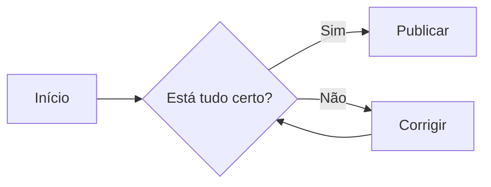

<a id="readme-top"></a>

<div align="center">

# Guia Completo de Formatação e Sintaxe do GitHub Markdown

**Como escrever, formatar e embelezar o README do perfil e de projectos**


</div>

---

## Introdução

O README é o cartão de visita de um perfil ou de um projecto no GitHub. É a primeira coisa que o visitante lê e, muitas vezes, a que decide se ele fica, usa o projecto ou segue o autor.

Este guia reúne, de forma organizada, tudo o que é necessário para escrever um bom README:

- a **sintaxe** do Markdown suportada pelo GitHub (*GitHub Flavored Markdown*), do básico ao avançado;
- os **recursos visuais** que tornam um README mais apelativo (distintivos, banners, estatísticas, ícones);
- **modelos prontos a copiar** para o README de perfil e para o README de projecto;
- **boas práticas**, lista de verificação e resolução dos problemas mais frequentes.

### Como ler os exemplos

Em quase todos os temas, o guia apresenta dois blocos:

- **Escrita**: o código que deve ser digitado;
- **Resultado**: o aspecto que o código tem depois de interpretado pelo GitHub.

> [!NOTE]
> Para que os exemplos de **Escrita** apareçam como texto e não sejam interpretados, estão dentro de blocos de código. Basta copiá-los e adaptá-los.

<details>
<summary><strong>Índice</strong></summary>

**Fundamentos da sintaxe**

1. [Introdução ao Markdown](#1-introdução-ao-markdown)
2. [Títulos](#2-títulos)
3. [Formatação de texto](#3-formatação-de-texto)
4. [Parágrafos, quebras de linha e linhas horizontais](#4-parágrafos-quebras-de-linha-e-linhas-horizontais)
5. [Alinhamento de conteúdo](#5-alinhamento-de-conteúdo)
6. [Listas](#6-listas)
7. [Ligações](#7-ligações)
8. [Imagens, GIF e vídeos](#8-imagens-gif-e-vídeos)
9. [Citações](#9-citações)
10. [Código](#10-código)
11. [Alertas](#11-alertas)
12. [Comentários ocultos](#12-comentários-ocultos)
13. [Tabelas](#13-tabelas)
14. [Secções recolhidas](#14-secções-recolhidas)
15. [Notas de rodapé](#15-notas-de-rodapé)
16. [Emojis](#16-emojis)
17. [Menções e referências](#17-menções-e-referências)
18. [Fórmulas matemáticas](#18-fórmulas-matemáticas)
19. [Diagramas e mapas](#19-diagramas-e-mapas)
20. [Cores](#20-cores)
21. [Caracteres especiais e escape](#21-caracteres-especiais-e-escape)

**Recursos visuais**

22. [Distintivos (badges)](#22-distintivos-badges)
23. [Banners e texto animado](#23-banners-e-texto-animado)
24. [Estatísticas e gráficos do GitHub](#24-estatísticas-e-gráficos-do-github)
25. [Ícones de tecnologias e ligações sociais](#25-ícones-de-tecnologias-e-ligações-sociais)

**Aplicação prática**

26. [README de perfil](#26-readme-de-perfil)
27. [README de projecto](#27-readme-de-projecto)
28. [Ficheiros complementares do repositório](#28-ficheiros-complementares-do-repositório)
29. [Boas práticas e lista de verificação](#29-boas-práticas-e-lista-de-verificação)
30. [Problemas frequentes e soluções](#30-problemas-frequentes-e-soluções)
31. [Referência rápida](#31-referência-rápida)
32. [Fontes e ligações úteis](#32-fontes-e-ligações-úteis)

</details>

---

## 1. Introdução ao Markdown

**Markdown** é uma linguagem de marcação simples: com alguns símbolos (`#`, `*`, `-`, `>`) transforma-se texto comum em texto formatado. O GitHub usa uma variante chamada **GitHub Flavored Markdown (GFM)**, que acrescenta tabelas, listas de tarefas, alertas, diagramas, fórmulas e outros recursos.

### Onde o Markdown funciona no GitHub

| Local | Exemplo |
| :--- | :--- |
| Ficheiros `.md` | `README.md`, `CONTRIBUTING.md`, `CHANGELOG.md` |
| *Issues* e *Pull Requests* | Descrição e comentários |
| Discussões | Publicações e respostas |
| *Gists* | Ficheiros com extensão `.md` |
| Versões (*Releases*) | Notas de lançamento |
| Wiki | Páginas do projecto |

### Onde editar

1. Directamente no GitHub: abrir o ficheiro e clicar no ícone do lápis (**Edit this file**). O separador **Preview** mostra o resultado antes de gravar.
2. No computador, com qualquer editor (por exemplo, o Visual Studio Code, que tem pré-visualização de Markdown com `Ctrl` + `Shift` + `V`).

### HTML dentro do Markdown

O GitHub aceita parte do HTML dentro do Markdown, o que permite centrar texto, redimensionar imagens, criar secções recolhidas e outros efeitos. Por razões de segurança, o GitHub **remove** certos elementos, como `<script>`, `<style>`, `<iframe>`, formulários e o atributo `style`. Atributos como `target="_blank"` também são ignorados.

<p align="right"><a href="#readme-top">↑ Ir ao topo</a></p>

---

## 2. Títulos

Os títulos organizam o conteúdo em níveis. Escreva de **um a seis cardinais** (`#`) no início da linha, seguidos de **um espaço** e do texto do título.

| Nível | Código | Utilização habitual |
| :---: | :--- | :--- |
| 1 | `# Título` | Nome do projecto (usar apenas um por documento) |
| 2 | `## Título` | Secções principais |
| 3 | `### Título` | Subsecções |
| 4 | `#### Título` | Detalhes dentro de uma subsecção |
| 5 | `##### Título` | Uso raro |
| 6 | `###### Título` | Uso raro |

Escrita:

```markdown
# Título de nível 1
## Título de nível 2
### Título de nível 3
#### Título de nível 4
##### Título de nível 5
###### Título de nível 6
```

Resultado (níveis 4 a 6; os níveis 1 a 3 foram omitidos para não alterarem o índice deste guia):

#### Título de nível 4
##### Título de nível 5
###### Título de nível 6

> [!NOTE]
> Quanto maior o número de cardinais, menor é o título e menor a sua importância. Deixe sempre uma linha em branco antes e depois de um título.

### Índice automático e âncoras

- O GitHub gera **automaticamente** um índice de qualquer ficheiro Markdown com títulos: clique no ícone de lista, no canto superior direito do ficheiro.
- Ao passar o rato sobre um título, aparece uma ligação que permite copiar o endereço directo para essa secção.
- Cada título recebe uma **âncora** (endereço interno) criada assim: letras em minúsculas, espaços substituídos por hífenes e pontuação removida. Os acentos mantêm-se.

| Título | Âncora gerada |
| :--- | :--- |
| `## Instalação` | `#instalação` |
| `## Como Contribuir` | `#como-contribuir` |
| `## 1. Primeiros passos` | `#1-primeiros-passos` |

Se dois títulos forem iguais, o segundo recebe o sufixo `-1`, o terceiro `-2`, e assim sucessivamente.

<p align="right"><a href="#readme-top">↑ Ir ao topo</a></p>

---

## 3. Formatação de texto

| Estilo | Escrita | Resultado |
| :--- | :--- | :--- |
| Negrito | `**texto**` ou `__texto__` | **texto** |
| Itálico | `*texto*` ou `_texto_` | *texto* |
| Negrito e itálico | `***texto***` | ***texto*** |
| Riscado | `~~texto~~` | ~~texto~~ |
| Sublinhado | `<ins>texto</ins>` | <ins>texto</ins> |
| Sobrescrito | `x<sup>2</sup>` | x<sup>2</sup> |
| Subscrito | `H<sub>2</sub>O` | H<sub>2</sub>O |
| Código em linha | `` `texto` `` | `texto` |
| Tecla do teclado | `<kbd>Ctrl</kbd> + <kbd>C</kbd>` | <kbd>Ctrl</kbd> + <kbd>C</kbd> |

### Combinações

| Combinação | Escrita | Resultado |
| :--- | :--- | :--- |
| Negrito dentro de itálico | `_texto **importante** texto_` | _texto **importante** texto_ |
| Negrito e riscado | `**~~texto~~**` | **~~texto~~** |
| Itálico e riscado | `*~~texto~~*` | *~~texto~~* |

> [!TIP]
> Use o **negrito** para realçar termos-chave e o *itálico* para ênfase leve ou termos estrangeiros. Realçar demasiado o texto faz com que nada se destaque.

<p align="right"><a href="#readme-top">↑ Ir ao topo</a></p>

---

## 4. Parágrafos, quebras de linha e linhas horizontais

### Parágrafos

Separe os parágrafos com **uma linha em branco**. Uma simples mudança de linha, sem linha em branco, **não** cria um novo parágrafo num ficheiro `.md`: as duas linhas aparecem juntas.

Escrita:

```markdown
Este é o primeiro parágrafo.

Este é o segundo parágrafo.
```

Resultado:

Este é o primeiro parágrafo.

Este é o segundo parágrafo.

### Quebra de linha dentro do mesmo parágrafo

Há três formas:

| Método | Como fazer |
| :--- | :--- |
| Etiqueta HTML (a mais fiável) | Escrever `<br>` onde se pretende mudar de linha |
| Dois espaços | Terminar a linha com dois espaços (invisíveis, fáceis de perder) |
| Barra invertida | Terminar a linha com `\` |

Escrita:

```markdown
Primeira linha<br>
Segunda linha<br><br>
Terceira linha, depois de uma linha em branco
```

Resultado:

Primeira linha<br>
Segunda linha<br><br>
Terceira linha, depois de uma linha em branco

### Linha horizontal

Use três ou mais hífenes (`---`), asteriscos (`***`) ou sublinhados (`___`) numa linha isolada. Deixe **uma linha em branco antes**: se o `---` ficar colado ao texto de cima, esse texto transforma-se num título.

Escrita:

```markdown
Texto acima

---

Texto abaixo
```

Resultado:

Texto acima

---

Texto abaixo

<p align="right"><a href="#readme-top">↑ Ir ao topo</a></p>

---

## 5. Alinhamento de conteúdo

O Markdown puro não alinha texto, mas o GitHub aceita o atributo HTML `align` em `<div>` e `<p>`. Valores possíveis: `left` (esquerda), `center` (centro) e `right` (direita). Funciona com texto, imagens, GIF e distintivos.

> [!IMPORTANT]
> Deixe **uma linha em branco** logo a seguir à abertura da `<div>` e antes do seu fecho; sem ela, o Markdown dentro da `<div>` não é interpretado.

Escrita:

```markdown
<div align="center">

**Texto centrado**

</div>

<div align="right">

**Texto alinhado à direita**

</div>
```

Resultado:

<div align="center">

**Texto centrado**

</div>

<div align="right">

**Texto alinhado à direita**

</div>

Para conteúdo sem Markdown no interior, pode usar-se `<p align="center">...</p>`, sem necessidade de linhas em branco:

```html
<p align="center">
  
</p>
```

<p align="right"><a href="#readme-top">↑ Ir ao topo</a></p>

---

## 6. Listas

### Lista não ordenada

Comece cada linha com `-`, `*` ou `+`, seguido de um espaço. Escolha um só símbolo e mantenha-o em todo o documento.

Escrita:

```markdown
- Maçã
- Banana
- Laranja
```

Resultado:

- Maçã
- Banana
- Laranja

### Lista ordenada

Comece cada linha com um número seguido de ponto. O GitHub numera automaticamente, por isso pode repetir o número `1.` em todas as linhas: facilita a reordenação.

Escrita:

```markdown
1. Descarregar o projecto
1. Instalar as dependências
1. Executar o programa
```

Resultado:

1. Descarregar o projecto
1. Instalar as dependências
1. Executar o programa

### Listas aninhadas

Indente o subitem com **dois a quatro espaços** (ou `Tab`) em relação ao item superior.

Escrita:

```markdown
1. Frutas
   - Maçã
   - Banana
     - Banana-prata
2. Legumes
   - Cenoura
```

Resultado:

1. Frutas
   - Maçã
   - Banana
     - Banana-prata
2. Legumes
   - Cenoura

### Lista de tarefas

Use `- [ ]` para tarefa pendente e `- [x]` para tarefa concluída. Muito útil num *roadmap*.

Escrita:

```markdown
- [x] Criar o repositório
- [x] Escrever o README
- [ ] Publicar a primeira versão
- [ ] \(Opcional) Traduzir a documentação
```

Resultado:

- [x] Criar o repositório
- [x] Escrever o README
- [ ] Publicar a primeira versão
- [ ] \(Opcional) Traduzir a documentação

> [!NOTE]
> Se o texto de uma tarefa começar com parêntesis curvo, é preciso fazer o seu *escape* com uma barra invertida: `\(`.

### Parágrafos e código dentro de listas

Para colocar um parágrafo ou um bloco de código dentro de um item, deixe uma linha em branco e indente o conteúdo com o mesmo recuo do texto do item.

Escrita:

````markdown
1. Clonar o repositório:

   ```bash
   git clone https://github.com/utilizador/projecto.git
   ```

2. Entrar na pasta:

   ```bash
   cd projecto
   ```
````

Resultado:

1. Clonar o repositório:

   ```bash
   git clone https://github.com/utilizador/projecto.git
   ```

2. Entrar na pasta:

   ```bash
   cd projecto
   ```

<p align="right"><a href="#readme-top">↑ Ir ao topo</a></p>

---

## 7. Ligações

### Ligação simples

Texto da ligação entre parêntesis rectos `[ ]` e endereço entre parêntesis curvos `( )`.

Escrita:

```markdown
[Perfil no GitHub](https://github.com/)
```

Resultado:

[Perfil no GitHub](https://github.com/)

### Ligação com título (dica ao passar o rato)

```markdown
[GitHub](https://github.com/ "Ir para o GitHub")
```

[GitHub](https://github.com/ "Ir para o GitHub")

### Ligação automática

Um endereço escrito por extenso torna-se ligação sem mais nada; entre `< >` fica explícito.

```markdown
https://github.com/
<https://github.com/>
```

### Ligação de referência

Útil quando o mesmo endereço é repetido várias vezes: define-se uma vez, no fim do ficheiro, e usa-se um nome.

```markdown
Consulte a [documentação][docs] ou o [guia][docs] do projecto.

[docs]: https://docs.github.com/
```

### Ligação de correio electrónico

```markdown
[Enviar mensagem](mailto:nome@exemplo.com)
```

### Ligação para outra secção do mesmo ficheiro

Use `#` seguido da âncora do título (ver [Títulos](#2-títulos)).

```markdown
Veja a secção de [instalação](#instalação).
```

Para criar um ponto de ancoragem personalizado (por exemplo, para o botão «Ir ao topo»), coloque uma âncora HTML no local pretendido:

```markdown
<a id="readme-top"></a>

[↑ Ir ao topo](#readme-top)
```

### Ligação relativa para outros ficheiros do repositório

Ligações relativas continuam a funcionar se o repositório mudar de nome, de ramo ou de proprietário. São preferíveis às ligações absolutas.

```markdown
[Guia de contribuição](./CONTRIBUTING.md)
[Licença](LICENSE)
[Documentação](docs/guia.md)
```

### Ligação para linhas de código

Num ficheiro do repositório, clique no número da linha, prima `y` para obter o endereço permanente e copie-o. Para um intervalo, use `#L10-L20` no fim do endereço.

### Imagem como ligação

Coloca-se a imagem dentro dos parêntesis rectos da ligação.

Escrita:

```markdown
[](https://github.com/)
```

Resultado:

[](https://github.com/)

Em HTML:

```html
<a href="https://github.com/"></a>
```

> [!WARNING]
> O GitHub ignora `target="_blank"`: não é possível forçar a abertura de uma ligação num novo separador a partir de um README.

<p align="right"><a href="#readme-top">↑ Ir ao topo</a></p>

---

## 8. Imagens, GIF e vídeos

### Sintaxe básica

É igual à da ligação, com um ponto de exclamação `!` no início. O texto entre parêntesis rectos é o **texto alternativo**, lido por leitores de ecrã e mostrado se a imagem não carregar. **Escreva-o sempre.**

```markdown

```

### Origem das imagens

| Origem | Exemplo |
| :--- | :--- |
| Dentro do repositório (recomendado) | `` |
| Endereço externo | `` |
| Arrastar para o editor do GitHub | O GitHub carrega o ficheiro e gera o endereço |

Boa prática: guardar as imagens numa pasta própria (`assets/`, `imagens/` ou `docs/`), com nomes sem espaços.

### Redimensionar imagens

O Markdown não define dimensões; use HTML. Indique **apenas a largura** para manter a proporção.

```html

```

### Centrar uma imagem

```html
<p align="center">
  
</p>
```

### Imagens diferentes para o modo claro e o modo escuro

O elemento `<picture>` com `prefers-color-scheme` mostra a imagem adequada ao tema do visitante. É especialmente útil para logótipos e banners.

Escrita:

```html
<picture>
  <source media="(prefers-color-scheme: dark)" srcset="assets/logo-escuro.png">
  <source media="(prefers-color-scheme: light)" srcset="assets/logo-claro.png">
  
</picture>
```

- `srcset` do modo escuro: imagem para quem usa o tema escuro;
- `srcset` do modo claro: imagem para quem usa o tema claro;
- `src` da etiqueta ``: imagem por omissão, usada se o navegador não suportar `<picture>`;
- `alt`: descrição para acessibilidade.

Alternativa mais simples (menos recomendada): acrescentar `#gh-dark-mode-only` ou `#gh-light-mode-only` ao fim do endereço da imagem.

```markdown


```

### GIF

Um GIF anima-se como qualquer imagem. São excelentes para demonstrar o funcionamento de uma aplicação em poucos segundos. Mantenha-os leves (idealmente abaixo de 5 MB).

```markdown

```

### Vídeos

No editor do GitHub (em *Issues*, *Pull Requests* ou ao editar um README no site), **arraste** um ficheiro `.mp4`, `.mov` ou `.webm` para a caixa de texto. O GitHub carrega o vídeo e insere o endereço, que passa a ser reproduzido directamente na página.

> [!TIP]
> Para vídeos longos (por exemplo, do YouTube), use uma imagem de pré-visualização com ligação para o vídeo:
>
> ```markdown
> [](https://www.youtube.com/watch?v=ID_DO_VIDEO)
> ```

<p align="right"><a href="#readme-top">↑ Ir ao topo</a></p>

---

## 9. Citações

Comece a linha com `>`. Serve para citar textos, destacar observações ou responder a alguém.

Escrita:

```markdown
> Esta é uma citação.
>
> Pode ter vários parágrafos.
>
>> E pode ter citações dentro de citações.
```

Resultado:

> Esta é uma citação.
>
> Pode ter vários parágrafos.
>
>> E pode ter citações dentro de citações.

> [!NOTE]
> Para chamar a atenção para avisos e dicas, prefira os [Alertas](#11-alertas).

<p align="right"><a href="#readme-top">↑ Ir ao topo</a></p>

---

## 10. Código

### Código em linha

Coloque o texto entre **crases** (`` ` ``). Use-o para nomes de comandos, ficheiros, variáveis e funções.

Escrita:

```markdown
Execute o comando `npm install` e abra o ficheiro `index.html`.
```

Resultado:

Execute o comando `npm install` e abra o ficheiro `index.html`.

Se o próprio código contiver crases, envolva-o com **duas crases** e espaços:

```markdown
`` Use `crases` assim ``
```

### Bloco de código

Use **três crases** antes e depois do código.

Escrita:

````markdown
```
npm install
npm start
```
````

Resultado:

```
npm install
npm start
```

### Realce de sintaxe

Indique a linguagem logo a seguir às três crases iniciais.

Escrita:

````markdown
```html
<!doctype html>
<html lang="pt">
<head>
  <meta charset="utf-8">
  <title>Página de teste</title>
</head>
<body>
  <h1>Olá, mundo!</h1>
</body>
</html>
```
````

Resultado:

```html
<!doctype html>
<html lang="pt">
<head>
  <meta charset="utf-8">
  <title>Página de teste</title>
</head>
<body>
  <h1>Olá, mundo!</h1>
</body>
</html>
```

Identificadores de linguagem mais usados:

| Linguagem | Identificador | Linguagem | Identificador |
| :--- | :--- | :--- | :--- |
| JavaScript | `javascript` ou `js` | Python | `python` ou `py` |
| TypeScript | `typescript` ou `ts` | Java | `java` |
| HTML | `html` | C# | `csharp` |
| CSS | `css` | PHP | `php` |
| JSON | `json` | SQL | `sql` |
| YAML | `yaml` | Linha de comandos | `bash` ou `shell` |
| Markdown | `markdown` ou `md` | Diferenças entre versões | `diff` |

### Mostrar alterações com `diff`

```diff
- linha removida
+ linha acrescentada
  linha inalterada
```

### Mostrar código Markdown que contém blocos de código

Quando o exemplo contém três crases, envolva-o com **quatro crases** (como neste guia):

`````markdown
````markdown
```js
console.log("Olá");
```
````
`````

### Estrutura de pastas

Use um bloco de código simples, sem linguagem:

```
projecto/
├── src/
│   ├── index.js
│   └── utilitarios.js
├── docs/
├── README.md
└── LICENSE
```

<p align="right"><a href="#readme-top">↑ Ir ao topo</a></p>

---

## 11. Alertas

Os alertas são uma extensão das citações que realça informação importante, com cor e ícone próprios. São suportados em ficheiros Markdown, *Issues*, *Pull Requests*, Discussões, *Gists* e Versões.

Há **cinco tipos**:

| Tipo | Quando usar |
| :--- | :--- |
| `NOTE` | Informação útil que o leitor deve conhecer, mesmo quando só lê por alto |
| `TIP` | Conselho para fazer melhor ou mais depressa |
| `IMPORTANT` | Informação essencial para alcançar o objectivo |
| `WARNING` | Aviso de um risco que exige atenção imediata |
| `CAUTION` | Aviso de consequências negativas graves |

Escrita:

```markdown
> [!NOTE]
> Informação útil.

> [!TIP]
> Conselho prático.

> [!IMPORTANT]
> Informação essencial.

> [!WARNING]
> Risco que exige atenção.

> [!CAUTION]
> Possíveis consequências graves.
```

Resultado:

> [!NOTE]
> Informação útil.

> [!TIP]
> Conselho prático.

> [!IMPORTANT]
> Informação essencial.

> [!WARNING]
> Risco que exige atenção.

> [!CAUTION]
> Possíveis consequências graves.

> [!TIP]
> O GitHub recomenda usar no máximo **um ou dois alertas por documento** e evitar alertas consecutivos, para não sobrecarregar o leitor. Alertas não podem ser colocados dentro de outros elementos.

<p align="right"><a href="#readme-top">↑ Ir ao topo</a></p>

---

## 12. Comentários ocultos

Texto colocado entre `<!--` e `-->` não aparece na página. Serve para deixar notas para si próprio, indicações para outros colaboradores ou desactivar temporariamente um bloco.

Escrita:

```markdown
Esta palavra <!-- escondida --> fica visível, mas a palavra entre os sinais não.

<!--
Lembrete: actualizar as capturas de ecrã antes da próxima versão.
-->
```

Resultado:

Esta palavra <!-- escondida --> fica visível, mas a palavra entre os sinais não.

<!--
Lembrete: actualizar as capturas de ecrã antes da próxima versão.
-->

> [!WARNING]
> Os comentários estão ocultos na página, mas **continuam visíveis** no código-fonte. Nunca coloque neles palavras-passe, chaves ou dados confidenciais.

<p align="right"><a href="#readme-top">↑ Ir ao topo</a></p>

---

## 13. Tabelas

Use barras verticais `|` para separar colunas e, na segunda linha, hífenes `-` para marcar o cabeçalho (mínimo de três por coluna). Deixe **uma linha em branco antes da tabela**.

Escrita:

```markdown
| Nome   | Função        | Estado     |
| ------ | ------------- | ---------- |
| Ana    | Programadora  | Activa     |
| Carlos | Designer      | De licença |
```

Resultado:

| Nome   | Função        | Estado     |
| ------ | ------------- | ---------- |
| Ana    | Programadora  | Activa     |
| Carlos | Designer      | De licença |

### Alinhamento das colunas

Coloque dois pontos `:` na linha dos hífenes:

| Código | Alinhamento |
| :---: | :--- |
| `:---` | à esquerda |
| `:---:` | ao centro |
| `---:` | à direita |

Escrita:

```markdown
| À esquerda | Ao centro | À direita |
| :--------- | :-------: | --------: |
| Texto      | Texto     | 100,00    |
| Texto      | Texto     | 2 500,00  |
```

Resultado:

| À esquerda | Ao centro | À direita |
| :--------- | :-------: | --------: |
| Texto      | Texto     | 100,00    |
| Texto      | Texto     | 2 500,00  |

### Dentro das células

| Pretende | Escreva |
| :--- | :--- |
| Barra vertical `\|` | `\|` |
| Mudança de linha | `<br>` |
| Código | `` `código` `` |
| Ligação ou imagem | `[texto](url)` ou `` |

> [!NOTE]
> As células não precisam de estar perfeitamente alinhadas no código, mas alinhá-las torna a tabela muito mais fácil de ler e de editar. As barras verticais nos extremos são opcionais.

<p align="right"><a href="#readme-top">↑ Ir ao topo</a></p>

---

## 14. Secções recolhidas

Com `<details>` e `<summary>`, o conteúdo fica escondido até o leitor clicar no título. É ideal para índices, listas longas, registos de erros e detalhes técnicos que não interessam a todos.

Escrita:

````markdown
<details>
<summary>Clique para ver os detalhes</summary>

### Pode ter um título

Pode ter texto, listas, imagens e blocos de código.

```python
print("Olá, mundo!")
```

</details>
````

Resultado:

<details>
<summary>Clique para ver os detalhes</summary>

### Pode ter um título

Pode ter texto, listas, imagens e blocos de código.

```python
print("Olá, mundo!")
```

</details>

### Secção já aberta por omissão

Acrescente o atributo `open`:

```html
<details open>
<summary>Esta secção começa aberta</summary>

Conteúdo visível desde o início.

</details>
```

> [!IMPORTANT]
> Deixe **uma linha em branco** a seguir a `</summary>` e antes de `</details>`; caso contrário, o Markdown do interior não será interpretado.

<p align="right"><a href="#readme-top">↑ Ir ao topo</a></p>

---

## 15. Notas de rodapé

As notas de rodapé permitem acrescentar referências ou esclarecimentos sem interromper o texto. O GitHub numera-as automaticamente e coloca-as no fim do documento, com uma ligação de regresso.

Escrita:

```markdown
O Markdown foi criado em 2004.[^historia] Muitos programadores usam-no diariamente.[^uso]

[^historia]: Os seus autores foram John Gruber e Aaron Swartz.
[^uso]: Sobretudo em documentação e em ficheiros README.
```

Resultado:

O Markdown foi criado em 2004.[^historia] Muitos programadores usam-no diariamente.[^uso]

[^historia]: Os seus autores foram John Gruber e Aaron Swartz.
[^uso]: Sobretudo em documentação e em ficheiros README.

> [!NOTE]
> As notas de rodapé não funcionam dentro de tabelas, de citações nem de secções `<details>`.

<p align="right"><a href="#readme-top">↑ Ir ao topo</a></p>

---

## 16. Emojis

Escreva o nome do emoji entre dois pontos (`:nome:`) ou cole o próprio emoji. Escreva `:` e as primeiras letras no editor do GitHub para ver sugestões.

Escrita:

```markdown
:rocket: Lançamento! :tada: Tudo pronto :white_check_mark:
```

Resultado:

:rocket: Lançamento! :tada: Tudo pronto :white_check_mark:

| Emoji | Código | Emoji | Código |
| :---: | :--- | :---: | :--- |
| :rocket: | `:rocket:` | :bulb: | `:bulb:` |
| :books: | `:books:` | :wrench: | `:wrench:` |
| :sparkles: | `:sparkles:` | :bug: | `:bug:` |
| :globe_with_meridians: | `:globe_with_meridians:` | :handshake: | `:handshake:` |
| :email: | `:email:` | :warning: | `:warning:` |

Lista completa: [Emoji Cheat Sheet](https://github.com/ikatyang/emoji-cheat-sheet).

> [!TIP]
> Os emojis são ótimos para marcar secções (por exemplo, `## :rocket: Instalação`), mas use-os com moderação. Atenção: nos títulos, o emoji faz parte da âncora gerada.

<p align="right"><a href="#readme-top">↑ Ir ao topo</a></p>

---

## 17. Menções e referências

Em *Issues*, *Pull Requests*, Discussões e comentários, o GitHub transforma automaticamente certos textos em ligações:

| Escrita | Resultado |
| :--- | :--- |
| `@utilizador` | Menciona uma pessoa e notifica-a |
| `@organização/equipa` | Menciona uma equipa de uma organização |
| `#123` | Liga à *issue* ou *pull request* número 123 do mesmo repositório |
| `utilizador/repositório#123` | Liga a uma *issue* de outro repositório |
| `a5c3785` (início do SHA de um *commit*) | Liga ao *commit* |
| `Fixes #123` ou `Closes #123` | Numa *pull request*, fecha a *issue* quando a PR for integrada |

> [!NOTE]
> Estas ligações automáticas **não** são criadas dentro de ficheiros `.md` do repositório (como o README). Num README, use ligações completas:
>
> ```markdown
> [Ver issue 123](https://github.com/utilizador/repositorio/issues/123)
> ```

<p align="right"><a href="#readme-top">↑ Ir ao topo</a></p>

---

## 18. Fórmulas matemáticas

O GitHub interpreta expressões **LaTeX** entre cifrões (`$ ... $`) na linha do texto e entre cifrões duplos (`$$ ... $$`) em bloco próprio.

Escrita:

```markdown
A fórmula é $x = \frac{-b \pm \sqrt{b^2 - 4ac}}{2a}$ para equações do 2.º grau.

$$
\sum_{i=1}^{n} i = \frac{n(n+1)}{2}
$$
```

Resultado:

A fórmula é $x = \frac{-b \pm \sqrt{b^2 - 4ac}}{2a}$ para equações do 2.º grau.

$$
\sum_{i=1}^{n} i = \frac{n(n+1)}{2}
$$

Para escrever um cifrão como texto normal (por exemplo, um preço), use `\$`.

<p align="right"><a href="#readme-top">↑ Ir ao topo</a></p>

---

## 19. Diagramas e mapas

### Diagramas com Mermaid

Escreva o diagrama num bloco de código com a linguagem `mermaid`. O GitHub desenha-o directamente, sem imagens.

Escrita:

````markdown

````

Resultado:


O Mermaid suporta fluxogramas, diagramas de sequência, de classes, de estados, cronogramas (Gantt), gráficos circulares e outros. Documentação: [mermaid.js.org](https://mermaid.js.org/).

### Mapas (GeoJSON e TopoJSON)

Um bloco com a linguagem `geojson` apresenta um mapa interactivo:

````markdown
```geojson
{
  "type": "Feature",
  "geometry": { "type": "Point", "coordinates": [-0.1278, 51.5074] },
  "properties": { "name": "Exemplo" }
}
```
````

### Modelos 3D (STL)

Um bloco com a linguagem `stl` mostra um modelo tridimensional. Ficheiros `.stl` do repositório também são apresentados em 3D no navegador.

<p align="right"><a href="#readme-top">↑ Ir ao topo</a></p>

---

## 20. Cores

Em *Issues*, *Pull Requests* e Discussões, códigos de cor escritos em código em linha mostram uma pequena amostra da cor:

```markdown
`#0969DA`
`rgb(9, 105, 218)`
`hsl(212, 92%, 45%)`
```

> [!NOTE]
> Este efeito não ocorre em ficheiros `.md` do repositório. Para mostrar cores num README, use uma imagem ou um distintivo (ver [secção 22](#22-distintivos-badges)): por exemplo, ``.

<p align="right"><a href="#readme-top">↑ Ir ao topo</a></p>

---

## 21. Caracteres especiais e escape

Para mostrar literalmente um símbolo que o Markdown usaria para formatar, coloque uma **barra invertida** (`\`) antes dele.

Escrita:

```markdown
\*Isto não fica em itálico\*
\# Isto não é um título
1\. Isto não é uma lista
```

Resultado:

\*Isto não fica em itálico\*

\# Isto não é um título

1\. Isto não é uma lista

Caracteres que podem ser escapados:

```
\   `   *   _   {}   []   ()   #   +   -   .   !   |   <   >   ~   $
```

Quando o texto contém `<` ou `>` e o GitHub os confunde com HTML, escreva `&lt;` e `&gt;`. Para um espaço que não quebra a linha, use `&nbsp;`.

<p align="right"><a href="#readme-top">↑ Ir ao topo</a></p>

---

## 22. Distintivos (badges)

Os **distintivos** (*badges*) são pequenas imagens que resumem informação: estado da construção, versão, licença, tecnologias, ligações sociais, etc. O serviço mais usado é o [Shields.io](https://shields.io/).

### Distintivo estático

Formato:

```
https://img.shields.io/badge/ETIQUETA-MENSAGEM-COR
```

Regras do endereço:

| Para escrever | Use |
| :--- | :--- |
| Espaço | `_` ou `%20` |
| Hífen `-` | `--` |
| Sublinhado `_` | `__` |
| Acentos | Codificados (por exemplo, `Licen%C3%A7a` para «Licença») |

Escrita:

```markdown


```

Resultado:


### Parâmetros úteis

Acrescentam-se ao endereço, depois de `?`, separados por `&`.

| Parâmetro | Função | Exemplo |
| :--- | :--- | :--- |
| `style` | Estilo do distintivo | `style=for-the-badge` |
| `logo` | Logótipo (nome do ícone do [Simple Icons](https://simpleicons.org/)) | `logo=python` |
| `logoColor` | Cor do logótipo | `logoColor=white` |
| `labelColor` | Cor da parte da etiqueta | `labelColor=black` |
| `color` | Cor da mensagem (nome ou código hexadecimal sem `#`) | `color=0969DA` |

Estilos disponíveis: `flat` (por omissão), `flat-square`, `plastic`, `for-the-badge` e `social`.

Escrita:

```markdown


```

Resultado:


> [!NOTE]
> Alguns logótipos de marcas foram retirados do Simple Icons ao longo do tempo, pelo que podem deixar de aparecer. Nesse caso o distintivo continua a funcionar, apenas sem o logótipo. Confirme sempre o nome do ícone em [simpleicons.org](https://simpleicons.org/).

### Distintivos dinâmicos do GitHub

Estes distintivos actualizam-se sozinhos, lendo dados do repositório. Substitua `UTILIZADOR/REPOSITORIO` pelos seus dados.

| Informação | Endereço |
| :--- | :--- |
| Estrelas | `https://img.shields.io/github/stars/UTILIZADOR/REPOSITORIO?style=social` |
| *Forks* | `https://img.shields.io/github/forks/UTILIZADOR/REPOSITORIO?style=social` |
| Licença | `https://img.shields.io/github/license/UTILIZADOR/REPOSITORIO` |
| Última versão | `https://img.shields.io/github/v/release/UTILIZADOR/REPOSITORIO` |
| Último *commit* | `https://img.shields.io/github/last-commit/UTILIZADOR/REPOSITORIO` |
| *Issues* abertas | `https://img.shields.io/github/issues/UTILIZADOR/REPOSITORIO` |
| Linguagem principal | `https://img.shields.io/github/languages/top/UTILIZADOR/REPOSITORIO` |
| Tamanho do repositório | `https://img.shields.io/github/repo-size/UTILIZADOR/REPOSITORIO` |
| Seguidores do utilizador | `https://img.shields.io/github/followers/UTILIZADOR?style=social` |
| Estado de um fluxo de trabalho (Actions) | `https://img.shields.io/github/actions/workflow/status/UTILIZADOR/REPOSITORIO/NOME.yml` |

Exemplo com um repositório real:

```markdown


```


### Distintivos com ligação

```markdown
[](./LICENSE)
```

> [!TIP]
> Não exagere: três a seis distintivos relevantes, agrupados no topo, dão uma boa imagem. Dezenas de distintivos tornam o README difícil de ler.

<p align="right"><a href="#readme-top">↑ Ir ao topo</a></p>

---

## 23. Banners e texto animado

Estes recursos são fornecidos por **serviços externos gratuitos** e são usados sobretudo em README de perfil.

> [!WARNING]
> Serviços externos podem ficar lentos, mudar de endereço ou deixar de funcionar. Para elementos essenciais (como o logótipo do seu projecto), guarde a imagem no próprio repositório. Teste sempre o endereço antes de publicar.

### Cabeçalho e rodapé decorativos (Capsule Render)

Gera faixas com ondas, gradientes e texto.

```markdown

```

Para o rodapé, use `section=footer`. Tipos disponíveis incluem `waving`, `venom`, `shark`, `slice`, `rect`, `cylinder` e outros.

### Texto a ser «digitado» (Readme Typing SVG)

Mostra frases que se escrevem uma após outra. Separe as frases com `;` e use `+` para os espaços.

```markdown
[](https://git.io/typing-svg)
```

### Imagem de contador de visitas

```markdown

```

### Cobra a comer as contribuições (Snake)

O projecto [Platane/snk](https://github.com/Platane/snk) gera, através de uma **GitHub Action**, uma animação em que uma cobra «come» o gráfico das suas contribuições. Siga as instruções do repositório para criar o fluxo de trabalho e depois insira o ficheiro SVG gerado no README.

<p align="right"><a href="#readme-top">↑ Ir ao topo</a></p>

---

## 24. Estatísticas e gráficos do GitHub

Todos os cartões abaixo são imagens geradas por serviços externos a partir dos dados públicos do seu perfil. Substitua `UTILIZADOR` pelo seu nome de utilizador no GitHub.

### Estatísticas gerais (GitHub Readme Stats)

```markdown

```

Parâmetros úteis: `theme` (por exemplo, `dark`, `radical`, `tokyonight`), `hide_border=true`, `include_all_commits=true`, `count_private=true`.

### Linguagens mais usadas

```markdown

```

### Cartão de um repositório

Ideal para destacar projectos.

```markdown
[](https://github.com/UTILIZADOR/NOME-DO-REPOSITORIO)
```

### Sequência de contribuições (*streak*)

```markdown

```

### Troféus

```markdown

```

### Gráfico de actividade

```markdown

```

> [!NOTE]
> A instância pública do *GitHub Readme Stats* tem limites de pedidos e pode falhar com frequência. Se isso acontecer, a solução recomendada pelo próprio projecto é alojar a sua própria instância (por exemplo, na Vercel). Consulte o repositório [anuraghazra/github-readme-stats](https://github.com/anuraghazra/github-readme-stats).

### Cartões lado a lado

Coloque as imagens numa `<div>` centrada, sem linhas em branco entre as imagens:

```html
<div align="center">
  
  
</div>
```

<p align="right"><a href="#readme-top">↑ Ir ao topo</a></p>

---

## 25. Ícones de tecnologias e ligações sociais

### Ícones de tecnologias (Skill Icons)

Uma única imagem mostra uma fila de ícones, indicados por nome e separados por vírgulas.

```markdown

```

Parâmetros: `&theme=light` (ícones para fundo claro) e `&perline=6` (número de ícones por linha). Lista de ícones: [skillicons.dev](https://skillicons.dev/).

### Distintivos de tecnologias

Alternativa com distintivos do Shields.io (ver [secção 22](#22-distintivos-badges)), que permite cores e nomes personalizados:

```markdown


```


### Ligações sociais e de contacto

Combine um distintivo com uma ligação:

```markdown
[](https://github.com/UTILIZADOR)
[](https://wa.me/NUMERO_COM_INDICATIVO)
[](https://t.me/UTILIZADOR)
[](mailto:nome@exemplo.com)
```

> [!CAUTION]
> Um README de perfil é **público**. Pense bem antes de publicar o número de telefone, o endereço pessoal ou outros dados sensíveis.

Lista de todos os distintivos disponíveis: [markdown-badges](https://github.com/Ileriayo/markdown-badges).

<p align="right"><a href="#readme-top">↑ Ir ao topo</a></p>

---

## 26. README de perfil

O README de perfil é um ficheiro que aparece **no topo da sua página de perfil** do GitHub, antes dos repositórios fixados. É a oportunidade de se apresentar.

### Como criar

1. Clique em **New** para criar um repositório novo.
2. Dê ao repositório **exactamente o mesmo nome do seu utilizador** do GitHub (por exemplo, se o utilizador é `ana-silva`, o repositório chama-se `ana-silva`).
3. Marque a opção **Public** (público).
4. Marque **Add a README file**. O GitHub apresenta uma mensagem a confirmar que se trata de um repositório especial.
5. Clique em **Create repository**.
6. Edite o `README.md` e grave (*Commit changes*). O conteúdo passa a aparecer no seu perfil.

> [!IMPORTANT]
> O repositório tem de ser **público** e o nome tem de ser **igual** ao do utilizador (sem diferenças de letras). Caso contrário, o README não aparece no perfil.

### O que incluir

| Elemento | Finalidade |
| :--- | :--- |
| Título ou banner | Causa uma primeira impressão visual |
| Apresentação curta | Quem é, o que faz, onde estuda ou trabalha |
| Tecnologias | Mostra as competências |
| Projectos em destaque | Atrai visitantes para o seu trabalho |
| Estatísticas | Mostra actividade (opcional) |
| Contactos e redes | Facilita o contacto |
| Objectivos e interesses | Humaniza o perfil |

### Modelo completo de README de perfil

Copie, cole no `README.md` do repositório do perfil e substitua o que estiver em MAIÚSCULAS.

````markdown
<div align="center">


[](https://git.io/typing-svg)

</div>

## :wave: Sobre mim

- :mortar_board: Estudo SEU CURSO em SUA INSTITUIÇÃO
- :telescope: Neste momento estou a trabalhar em **NOME DO PROJECTO**
- :seedling: Estou a aprender **TECNOLOGIA**
- :handshake: Gostaria de colaborar em projectos de **ÁREA**
- :speech_balloon: Pergunte-me sobre **ASSUNTO**
- :earth_africa: Vivo em SUA CIDADE, SEU PAÍS

## :hammer_and_wrench: Tecnologias


## :bar_chart: Estatísticas

<div align="center">


</div>

## :file_folder: Projectos em destaque

| Projecto | Descrição | Tecnologias |
| :--- | :--- | :--- |
| [Projecto 1](https://github.com/UTILIZADOR/projecto-1) | Breve descrição | HTML, CSS, JS |
| [Projecto 2](https://github.com/UTILIZADOR/projecto-2) | Breve descrição | Python |

## :email: Contactos

[](https://github.com/UTILIZADOR)
[](mailto:nome@exemplo.com)


````

### Dicas para o perfil

- Mantenha-o **curto e actual**: o visitante lê em segundos.
- Teste a página em **modo claro e escuro** e no telemóvel.
- Fixe (*pin*) até seis repositórios de que mais se orgulha.
- Use o repositório do perfil também para guardar as imagens do README.

<p align="right"><a href="#readme-top">↑ Ir ao topo</a></p>

---

## 27. README de projecto

O README de projecto explica **o que é o projecto, para que serve e como usá-lo**. Quem o abre quer responder a cinco perguntas rapidamente:

1. O que é isto?
2. Para que serve?
3. Como o instalo?
4. Como o utilizo?
5. Como posso ajudar ou obter ajuda?

### Onde o GitHub procura o README

O GitHub mostra o README na página inicial do repositório. Se existirem vários, escolhe-o por esta ordem de prioridade:

1. pasta `.github`;
2. raiz do repositório;
3. pasta `docs`.

> [!NOTE]
> O GitHub mostra apenas os primeiros **500 KiB** de um README; o que passar desse limite é cortado. Para documentação extensa, divida o conteúdo por ficheiros em `docs/` e ligue-os a partir do README.

### Estrutura recomendada

| Ordem | Secção | Conteúdo |
| :---: | :--- | :--- |
| 1 | Título, logótipo e distintivos | Nome do projecto, imagem e estado |
| 2 | Descrição | Uma ou duas frases sobre o que o projecto faz |
| 3 | Demonstração | Captura de ecrã, GIF ou ligação para a versão em linha |
| 4 | Índice | Obrigatório em READMEs longos |
| 5 | Funcionalidades | Lista das principais características |
| 6 | Tecnologias | Linguagens, *frameworks* e ferramentas |
| 7 | Pré-requisitos | O que é necessário ter instalado |
| 8 | Instalação | Passos numerados, com código |
| 9 | Utilização | Exemplos práticos de uso |
| 10 | Configuração | Variáveis, opções, ficheiros de configuração |
| 11 | Estrutura do projecto | Árvore de pastas (opcional) |
| 12 | Testes | Como executar os testes |
| 13 | *Roadmap* | Funcionalidades previstas (lista de tarefas) |
| 14 | Como contribuir | Regras para colaborar |
| 15 | Licença | Tipo de licença |
| 16 | Autores e agradecimentos | Créditos |
| 17 | Contactos e suporte | Onde pedir ajuda |

### Modelo completo de README de projecto

Copie para o `README.md` do projecto e adapte. Apague as secções que não se aplicam.

````markdown
<a id="readme-top"></a>

<div align="center">

<picture>
  <source media="(prefers-color-scheme: dark)" srcset="assets/logo-escuro.png">
  <source media="(prefers-color-scheme: light)" srcset="assets/logo-claro.png">
  
</picture>

# NOME DO PROJECTO

**Uma frase curta que explica o que o projecto faz.**


[Demonstração](https://exemplo.com) · [Documentação](./docs) · [Reportar erro](https://github.com/UTILIZADOR/REPOSITORIO/issues) · [Pedir funcionalidade](https://github.com/UTILIZADOR/REPOSITORIO/issues)

</div>

<details>
<summary><strong>Índice</strong></summary>

- [Sobre o projecto](#sobre-o-projecto)
- [Funcionalidades](#funcionalidades)
- [Tecnologias](#tecnologias)
- [Primeiros passos](#primeiros-passos)
  - [Pré-requisitos](#pré-requisitos)
  - [Instalação](#instalação)
- [Utilização](#utilização)
- [Configuração](#configuração)
- [Estrutura do projecto](#estrutura-do-projecto)
- [Roadmap](#roadmap)
- [Como contribuir](#como-contribuir)
- [Licença](#licença)
- [Autores](#autores)
- [Agradecimentos](#agradecimentos)

</details>

---

## Sobre o projecto

Descreva o problema que o projecto resolve, a quem se destina e o que o distingue de outras soluções.

<p align="center">
  
</p>

## Funcionalidades

- :white_check_mark: Funcionalidade 1
- :white_check_mark: Funcionalidade 2
- :white_check_mark: Funcionalidade 3

## Tecnologias


## Primeiros passos

### Pré-requisitos

- [Node.js](https://nodejs.org/) 18 ou superior
- [Git](https://git-scm.com/)

### Instalação

1. Clone o repositório:

   ```bash
   git clone https://github.com/UTILIZADOR/REPOSITORIO.git
   ```

2. Entre na pasta do projecto:

   ```bash
   cd REPOSITORIO
   ```

3. Instale as dependências:

   ```bash
   npm install
   ```

4. Inicie a aplicação:

   ```bash
   npm start
   ```

## Utilização

Explique, com exemplos, como usar o projecto:

```js
import { funcao } from "NOME-DO-PROJECTO";

funcao("exemplo");
```

## Configuração

| Variável | Descrição | Valor por omissão |
| :--- | :--- | :--- |
| `PORT` | Porta em que a aplicação arranca | `3000` |
| `API_URL` | Endereço da API | `http://localhost:8080` |

## Estrutura do projecto

```
REPOSITORIO/
├── src/
├── assets/
├── docs/
├── README.md
└── LICENSE
```

## Roadmap

- [x] Versão inicial
- [ ] Autenticação de utilizadores
- [ ] Tradução para outras línguas

Consulte as [issues abertas](https://github.com/UTILIZADOR/REPOSITORIO/issues) para ver a lista completa de propostas.

## Como contribuir

As contribuições são bem-vindas. Leia o [guia de contribuição](./CONTRIBUTING.md) e siga estes passos:

1. Faça um *fork* do projecto
2. Crie um ramo para a sua alteração (`git checkout -b funcionalidade/minha-funcionalidade`)
3. Grave as alterações (`git commit -m "Acrescenta minha funcionalidade"`)
4. Envie o ramo (`git push origin funcionalidade/minha-funcionalidade`)
5. Abra uma *Pull Request*

## Licença

Distribuído sob a licença MIT. Consulte o ficheiro [LICENSE](./LICENSE) para mais informações.

## Autores

- **SEU NOME**: [@UTILIZADOR](https://github.com/UTILIZADOR)

## Agradecimentos

- [Shields.io](https://shields.io/)
- [Choose a License](https://choosealicense.com/)

<p align="right"><a href="#readme-top">↑ Ir ao topo</a></p>
````

<p align="right"><a href="#readme-top">↑ Ir ao topo</a></p>

---

## 28. Ficheiros complementares do repositório

Para além do README, o GitHub reconhece outros ficheiros que tornam o projecto profissional. O separador **Insights → Community Standards** do repositório mostra o que falta.

| Ficheiro | Finalidade | Localização |
| :--- | :--- | :--- |
| `LICENSE` | Define o que os outros podem fazer com o código. Sem licença, ninguém tem autorização para o reutilizar. Ajuda a escolher: [choosealicense.com](https://choosealicense.com/) | Raiz |
| `CONTRIBUTING.md` | Explica como colaborar (regras de código, ramos, testes) | Raiz, `.github` ou `docs` |
| `CODE_OF_CONDUCT.md` | Regras de comportamento da comunidade | Raiz, `.github` ou `docs` |
| `SECURITY.md` | Como comunicar vulnerabilidades de segurança | Raiz, `.github` ou `docs` |
| `CHANGELOG.md` | Histórico das alterações por versão (modelo em [keepachangelog.com](https://keepachangelog.com/)) | Raiz |
| `CITATION.cff` | Permite citar o projecto em trabalhos académicos (aparece o botão **Cite this repository**) | Raiz |
| `.gitignore` | Lista de ficheiros que o Git deve ignorar | Raiz |
| `.github/ISSUE_TEMPLATE/` | Modelos para abrir *issues* (erro, sugestão, pergunta) | `.github` |
| `.github/PULL_REQUEST_TEMPLATE.md` | Modelo para descrever *pull requests* | `.github` |
| `.github/FUNDING.yml` | Mostra o botão **Sponsor** | `.github` |

> [!TIP]
> Se a mesma pessoa mantiver muitos repositórios, pode criar um repositório público chamado `.github` na sua conta ou organização, com ficheiros de comunidade que serão usados por omissão em todos os repositórios que não tenham os seus.

### Organização de um repositório

Também é possível criar um README para a **organização**: crie um repositório público chamado `.github` e, dentro dele, uma pasta `profile` com um ficheiro `README.md`.

<p align="right"><a href="#readme-top">↑ Ir ao topo</a></p>

---

## 29. Boas práticas e lista de verificação

### Escrita

- Escreva para quem **não conhece** o projecto: evite siglas sem explicação.
- Comece pelo essencial: o que é, para que serve e como usar.
- Use frases curtas, verbos no imperativo nas instruções («Instale», «Execute») e um tom consistente.
- Escolha **uma língua** principal e, se possível, ofereça traduções em ficheiros separados (por exemplo, `README.en.md`).
- Revise a ortografia antes de publicar.

### Estrutura

- Use **um só título de nível 1**, o do nome do projecto.
- Não salte níveis (de `##` directamente para `####`).
- Inclua um **índice** em documentos longos.
- Divida conteúdo extenso em vários ficheiros e ligue-os entre si.

### Visual

- Use imagens e GIF **leves** e com texto alternativo.
- Prefira caminhos relativos para imagens do próprio repositório.
- Limite os distintivos e os efeitos: o conteúdo é mais importante do que a decoração.
- Verifique a legibilidade nos modos claro e escuro.

### Manutenção

- Actualize o README sempre que a instalação, a utilização ou as dependências mudarem.
- Teste os comandos de instalação num ambiente limpo.
- Confirme periodicamente se as ligações e as imagens externas continuam a funcionar.

### Lista de verificação final

- [ ] O título e a descrição explicam claramente o projecto
- [ ] Há uma captura de ecrã, GIF ou exemplo de utilização
- [ ] As instruções de instalação foram testadas
- [ ] Os exemplos de código têm realce de sintaxe
- [ ] Todas as imagens têm texto alternativo
- [ ] Todas as ligações funcionam
- [ ] A licença está indicada
- [ ] Há forma de contactar o autor ou de pedir ajuda
- [ ] Não existem dados confidenciais (palavras-passe, chaves, números de telefone)
- [ ] A pré-visualização foi verificada no GitHub (**Preview**)

<p align="right"><a href="#readme-top">↑ Ir ao topo</a></p>

---

## 30. Problemas frequentes e soluções

| Problema | Causa provável | Solução |
| :--- | :--- | :--- |
| A tabela aparece como texto simples | Falta uma linha em branco antes da tabela ou a linha de hífenes está mal escrita | Deixar uma linha em branco antes e usar pelo menos três hífenes por coluna |
| O Markdown dentro de `<div>` ou `<details>` não é formatado | Falta a linha em branco depois da etiqueta de abertura | Deixar uma linha em branco a seguir à abertura (e a seguir a `</summary>`) |
| A imagem não aparece | Caminho errado, nome com espaços ou diferença entre maiúsculas e minúsculas | Verificar o caminho exacto; evitar espaços e acentos nos nomes de ficheiros |
| A imagem aparece no GitHub mas não noutro sítio | Caminho relativo | Usar endereço absoluto onde o README for copiado para fora do GitHub |
| A ligação interna (`#secção`) não funciona | Âncora escrita de forma diferente do título | Copiar o endereço da secção ao passar o rato sobre o título |
| A quebra de linha não funciona | Mudança de linha simples num `.md` | Usar `<br>`, dois espaços ou `\` no fim da linha |
| O título não é reconhecido | Falta o espaço depois do `#` | Escrever `# Título`, não `#Título` |
| `---` transformou o texto em título | Linha horizontal colada ao parágrafo anterior | Deixar uma linha em branco antes de `---` |
| O estilo ou o *script* HTML não funciona | O GitHub remove `<style>`, `<script>`, `style=""` | Usar apenas as etiquetas e atributos suportados |
| `target="_blank"` não tem efeito | O GitHub ignora o atributo | Não é possível; deixe o leitor decidir |
| Os cartões de estatísticas não carregam | Serviço externo indisponível ou limite de pedidos | Tentar mais tarde ou alojar a própria instância |
| O README do perfil não aparece | Repositório privado ou nome diferente do utilizador | Tornar o repositório público e dar-lhe exactamente o nome do utilizador |
| O alerta aparece como citação normal | Sintaxe errada | A primeira linha deve ser só `> [!NOTE]`, com o tipo em maiúsculas |

<p align="right"><a href="#readme-top">↑ Ir ao topo</a></p>

---

## 31. Referência rápida

| Elemento | Sintaxe |
| :--- | :--- |
| Título | `# Título` a `###### Título` |
| Negrito | `**texto**` |
| Itálico | `*texto*` |
| Riscado | `~~texto~~` |
| Sublinhado | `<ins>texto</ins>` |
| Sobrescrito / subscrito | `<sup>2</sup>` / `<sub>2</sub>` |
| Tecla | `<kbd>Ctrl</kbd>` |
| Quebra de linha | `<br>` |
| Linha horizontal | `---` |
| Lista | `- item` |
| Lista ordenada | `1. item` |
| Lista de tarefas | `- [x] feito` / `- [ ] por fazer` |
| Ligação | `[texto](url)` |
| Imagem | `` |
| Imagem com ligação | `[](url)` |
| Citação | `> texto` |
| Código em linha | `` `código` `` |
| Bloco de código | ```` ```linguagem ```` … ```` ``` ```` |
| Alerta | `> [!NOTE]` + `> texto` |
| Tabela | `\| A \| B \|` + `\| --- \| --- \|` |
| Secção recolhida | `<details><summary>…</summary>…</details>` |
| Comentário oculto | `<!-- comentário -->` |
| Nota de rodapé | `texto[^1]` + `[^1]: nota` |
| Emoji | `:rocket:` |
| Fórmula | `$x^2$` ou `$$ … $$` |
| Diagrama | ```` ```mermaid ```` |
| Alinhar | `<div align="center">` |
| Âncora personalizada | `<a id="nome"></a>` + `[ir](#nome)` |
| Escape | `\*` |

<p align="right"><a href="#readme-top">↑ Ir ao topo</a></p>

---

## 32. Fontes e ligações úteis

**Documentação oficial do GitHub**

- [Sintaxe básica de escrita e formatação](https://docs.github.com/pt/get-started/writing-on-github/getting-started-with-writing-and-formatting-on-github/basic-writing-and-formatting-syntax)
- [Sobre os README](https://docs.github.com/pt/repositories/managing-your-repositorys-settings-and-features/customizing-your-repository/about-readmes)
- [Documentação do GitHub (português)](https://docs.github.com/pt)

**Ferramentas e recursos**

- [Shields.io](https://shields.io/): distintivos
- [Simple Icons](https://simpleicons.org/): ícones e cores de marcas
- [Skill Icons](https://skillicons.dev/): ícones de tecnologias
- [Markdown Badges](https://github.com/Ileriayo/markdown-badges): colecção de distintivos prontos
- [Emoji Cheat Sheet](https://github.com/ikatyang/emoji-cheat-sheet): lista de emojis
- [GitHub Readme Stats](https://github.com/anuraghazra/github-readme-stats): cartões de estatísticas
- [Mermaid](https://mermaid.js.org/): diagramas
- [Choose a License](https://choosealicense.com/): escolha de licença
- [Keep a Changelog](https://keepachangelog.com/): modelo de registo de alterações
- [Make a README](https://www.makeareadme.com/): orientações para escrever README

> [!NOTE]
> Os serviços de terceiros mencionados neste guia podem alterar os seus endereços, parâmetros ou disponibilidade. Em caso de dúvida, consulte a documentação de cada serviço.

---

<div align="center">

**Bom trabalho e boa escrita!**

<a href="#readme-top">↑ Voltar ao início</a>

</div>
